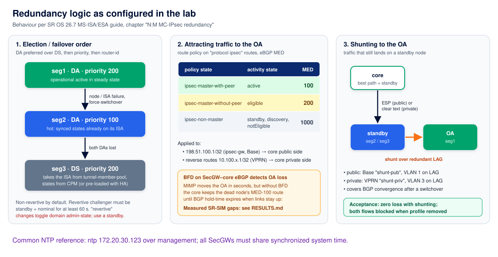

# SR OS N:M MC-IPsec security gateway lab (containerlab, SR-SIM 26.7)

A containerlab lab that reproduces a three-node **N:M multi-chassis IPsec** security gateway (SecGW) on
Nokia 7750 SR-7 **SR-SIM 26.7.R2**, with real IKEv2/ESP traffic from strongSwan "eNB" emulators. It
includes an automated switchover test runner.

- [TEST-PLAN.md](TEST-PLAN.md) explains the test program: what each scenario does, how it is
  measured, and what passes.
- [RESULTS.md](RESULTS.md) has the results of one full run, the findings, and the limits of the
  results.




## What is modelled

| Node | Role | Hardware (SR-SIM) |
|---|---|---|
| `seg1` | SecGW, **designated active (DA)**, priority 200 | 7750 SR-7, CPM5, `iom4-e`: `me10-10gb-sfp+` + `isa2-tunnel` (MS-ISA2) |
| `seg2` | SecGW, **designated active (DA)**, priority 100 | same |
| `seg3` | SecGW, **designated standby (DS)**, priority 200, ISA in a `tunnel-member-pool` | same |
| `ipmpls` | "IP/MPLS" core: Base = public side, VPRN `mobile` = private side | 7750 SR-1 |
| `enb1`, `enb2` | IKEv2 PSK initiators (strongSwan 5.9) with inner addresses 10.100.x.1 | Linux |
| `mme` | traffic target 10.200.0.10 behind the private side | Linux |

All three SecGWs are in one N:M redundancy domain (`ipsec-domain 1` ↔ `tunnel-group 1`), with one
MS-ISA2 per node (`active-isa-number 1`):

- Every pair of SecGWs is joined by **two direct links**, six links in total. These carry OSPF + BFD
  in the Base router, with MIMPv2 and MCS between the system addresses. Link A also carries the
  shunt interfaces.
- The gateway address 198.51.100.1 is the same on all nodes. It and the reverse routes are announced
  to the core over eBGP. The MED depends on the MIMP state: `ipsec-master-with-peer` 100,
  `ipsec-master-without-peer` 200, `ipsec-non-master` 1000.
- The core BGP sessions use BFD.
- The SecGWs are responder-only, use DPD `reply-only`, and have longer IKE/CHILD lifetimes than the
  eNBs. These are the SR OS MC-IPsec deployment requirements.

## Requirements

- Linux or WSL2 with Docker and **containerlab ≥ 0.80**. The `sfm:` key is at node level, which needs
  0.80.
- Image `registry.srlinux.dev/pub/nokia_srsim:26.7.R2`.
- An **SR-SIM license valid for 26.7**, saved as `license.txt` in the repo root. It is not included.
- About 9 GB of free RAM. Each SR-7 uses about 1.8 GB (CPM + IOM container), the SR-1 about 1.8 GB.
- `sshpass` on the host, used by the CLI helper scripts.
- The VS Code **containerlab** extension is optional. The `*.annotations.json` file gives the
  TopoViewer layout.

## Quick start

```bash
docker build -t enb-strongswan:local images/enb        # strongSwan on top of network-multitool
cp /path/to/your/srsim-26.7-license.txt license.txt
python3 gen_configs.py                                  # (re)generates configs/ ; already committed
sudo containerlab deploy -t nm-mc-ipsec.clab.yml
./tests/nm_tests.sh T0                                  # baseline check
./tests/nm_tests.sh all                                 # full program, ~1.5-2 h on a laptop
cat results/SUMMARY.md
```

The eNBs start IKE automatically and keep retrying until the SecGWs are up. If they gave up, run:
`docker exec clab-nm-mc-ipsec-enb1 swanctl --initiate --child s1u`.

## Repository layout

| Path | Content |
|---|---|
| `nm-mc-ipsec.clab.yml` | containerlab topology |
| `nm-mc-ipsec.clab.yml.annotations.json` | TopoViewer layout: groups, role labels, notes |
| `gen_configs.py` | single source of truth for addressing; generates `configs/*.partial.cfg` (MD-CLI) and the strongSwan configs |
| `configs/` | generated SR OS partial startup configs, eNB start script and `swanctl.conf` |
| `images/enb/Dockerfile` | eNB image (strongSwan) |
| `sros.sh` | run MD-CLI commands on a node over SSH (`./sros.sh seg1 'show ...'`) |
| `apply_cfg.sh` | merge and commit an MD-CLI snippet on one or more nodes |
| `tests/nm_tests.sh` | test runner, see TEST-PLAN.md |
| `results/raw/` | per-test logs (`Tn.md`) and per-eNB ping traces (`Tn-enbX.ping`) from the run in RESULTS.md |

## Useful commands

```bash
./sros.sh seg1 'show redundancy multi-chassis ipsec-domain 1'      # role, activity state, protection status
./sros.sh seg1 'show redundancy multi-chassis sync'                # MCS state per peer
./sros.sh seg1 'show ipsec gateway name "enb-gw" tunnel'           # dynamic tunnels
./sros.sh ipmpls 'show router bgp routes 198.51.100.1/32'          # which SecGW the core prefers
docker exec clab-nm-mc-ipsec-enb1 swanctl --list-sas
```

## Disclaimer

This is a lab for functional behaviour. SR-SIM emulates the control and management plane and limits
port throughput to 1000 pps. The absolute switchover times are therefore **not** representative of
hardware. Compare the scenarios with each other instead. This is not an official Nokia deliverable.
