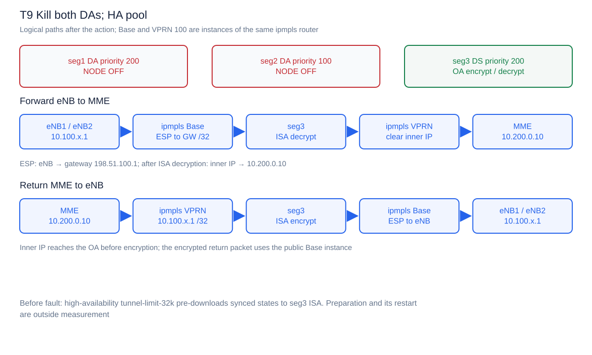
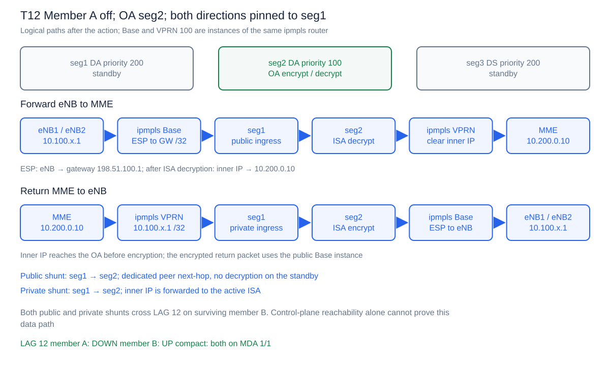

# Результаты испытаний N:M MC-IPsec

**Дата испытаний: 24–25 октября 2026 года.** Программа compact-профиля завершена:
23 измеряемых окна соответствуют установленным функциональным критериям.
Подтверждены stateful switchover между DA, takeover на DS в обычном и HA режимах,
возврат узлов, public/private shunting и работа оставшегося участника LAG.

Подробные действия, пути пакетов в обоих направлениях и отдельная схема каждого окна
приведены в [программе испытаний](docs/TEST-PROGRAM-RU.md).

## Испытанный стенд

| Параметр | Значение |
|---|---|
| SR OS | SR-SIM 26.7.R2 |
| Orchestrator | containerlab 0.80.0 |
| SecGW | Три 7750 SR-7, CPM5, по одному IOM4-e и MS-ISA2 |
| Роли | seg1 DA priority 200; seg2 DA priority 100; seg3 DS priority 200 |
| Core | 7750 SR-1: Base public и VPRN 100 private |
| Инициаторы | Два Linux eNB, strongSwan 5.9.12, IKEv2/ESP |
| Контрольный трафик | По 10 ICMP echo/s от inner address каждого eNB к 10.200.0.10 |
| Межузловые связи | LAG 12/13/23, по два LACP member ports; VLAN 1 public/control, VLAN 3 private |
| Время | Общий NTP 172.20.30.123 по management; chronyd -x, local stratum 10 |
| Среда | WSL2, 12 logical CPU, 17,15 ГиБ RAM, 5 ГиБ swap |
| Хост | Intel i5-1245U, 32 ГиБ RAM |

Программа выполнялась последовательными группами. Таблица ниже объединяет финальные
принятые измерения каждого сценария; происхождение каждого окна указано в разделе
«Исходные данные». Это функциональная проверка двух туннелей. Численные gaps относятся
к данному SR-SIM стенду; параметры аппаратного SLA и нагрузочного теста согласуются отдельно.

## Итоговая таблица

Для каждого eNB показаны число потерянных пакетов и максимальный интервал без ответа.
Ссылка в первом столбце открывает журнал соответствующего окна.

| Окно | OA после | IKE сохранены | eNB1: потери / max gap | eNB2: потери / max gap | Оценка |
|---|---|---|---|---|---|
| [T0](results/validated-compact-20261025-072430/T0.log) | seg1 | да | 0 / 0.103 с | 0 / 0.103 с | PASS |
| [T1](results/validated-compact-20261024-212054/T1.log) | seg2 | да | 3 / 0.440 с | 3 / 0.440 с | PASS |
| [T1b](results/validated-compact-20261024-212054/T1b.log) | seg1 | да | 3 / 0.440 с | 3 / 0.443 с | PASS |
| [T2](results/validated-compact-20261024-212948/T2.log) | seg2 | да | 3 / 0.436 с | 3 / 0.461 с | PASS |
| [T3](results/validated-compact-20261024-212948/T3.log) | seg2 | да | 0 / 0.161 с | 0 / 0.184 с | PASS |
| [T4](results/validated-compact-20261024-212948/T4.log) | seg1 | да | 3 / 0.426 с | 3 / 0.431 с | PASS |
| [T5](results/validated-compact-20261024-212948/T5.log) | seg1 | да | 0 / 0.119 с | 0 / 0.134 с | PASS |
| [T6](results/validated-compact-20261024-212948/T6.log) | seg1 | да | 0 / 0.107 с | 0 / 0.109 с | PASS |
| [T7](results/validated-compact-20261024-212948/T7.log) | seg2 | да | 25 / 2.947 с | 25 / 2.953 с | PASS |
| [T7-noBFD](results/validated-compact-20261024-212948/T7-noBFD.log) | seg2 | да | 744 / 84.238 с | 742 / 84.187 с | PASS |
| [T8](results/validated-compact-20261024-215807/T8.log) | seg3 | да | 25 / 2.948 с | 26 / 3.033 с | PASS |
| [T8r](results/validated-compact-20261024-215807/T8r.log) | seg3 | да | 0 / 0.184 с | 0 / 0.154 с | PASS |
| [T9](results/validated-compact-20261025-072430/T9.log) | seg3 | да | 24 / 2.811 с | 22 / 2.602 с | PASS |
| [T9r](results/validated-compact-20261025-072430/T9r.log) | seg3 | да | 0 / 0.105 с | 0 / 0.105 с | PASS |
| [T10-seg2](results/validated-compact-20261025-070431/T10-seg2.log) | seg1 | да | 0 / 0.104 с | 0 / 0.103 с | PASS |
| [T10b-seg2](results/validated-compact-20261025-070431/T10b-seg2.log) | seg1 | да | 93 / 10.534 с — блокировка | 95 / 10.843 с — блокировка | PASS |
| [T10-seg3](results/validated-compact-20261025-070431/T10-seg3.log) | seg1 | да | 0 / 0.104 с | 0 / 0.104 с | PASS |
| [T10b-seg3](results/validated-compact-20261025-070431/T10b-seg3.log) | seg1 | да | 92 / 10.507 с — блокировка | 96 / 10.827 с — блокировка | PASS |
| [T11-seg2](results/validated-compact-20261025-070431/T11-seg2.log) | seg1 | да | 0 / 0.103 с | 0 / 0.104 с | PASS |
| [T11b-seg2](results/validated-compact-20261025-070431/T11b-seg2.log) | seg1 | да | 93 / 10.582 с — блокировка | 95 / 10.800 с — блокировка | PASS |
| [T11-seg3](results/validated-compact-20261025-070431/T11-seg3.log) | seg1 | да | 0 / 0.118 с | 0 / 0.105 с | PASS |
| [T11b-seg3](results/validated-compact-20261025-070431/T11b-seg3.log) | seg1 | да | 92 / 10.558 с — блокировка | 94 / 10.793 с — блокировка | PASS |
| [T12](results/validated-compact-20261025-070431/T12.log) | seg2 | да | 1 / 0.205 с | 2 / 0.314 с | PASS |

В каждом принятом окне сохранены обе исходные IKE SA: проверены два SPI каждой сессии
до и после действия. CHILD SA установлены; CHILD rekey при switchover допускается.
Активная роль проверяется по всему домену с учётом состояния eligible изолированного DS.

Gap включает начало окна, интервалы между ответами и хвост после последнего ответа.
Даже при отсутствии потерь 10-pps поток имеет нормальный интервал около 0,1 с.
Метрика отражает наблюдения ICMP и планирование хоста, а не точное аппаратное время forwarding.

В T10b/T11b блокировка после снятия профиля является **ожидаемым результатом контрольного
испытания**. Начальная часть окна содержит успешные ответы до действия; после удаления
профиля оба потока остаются заблокированными до конца наблюдения. Соответствующий gap —
длительность наблюдённой блокировки, а не время восстановления. Профиль возвращается
после завершения контрольного окна.

## Подтверждённое поведение

### Переключение и возврат ISA

T1/T1b подтверждают управляемое переключение seg1 → seg2 → seg1 с сохранением IKE.
При отключении активной ISA в T2 владельцем становится seg2. Возврат ISA в T3 не меняет
OA в non-revertive режиме и проходит без потерь.

T4 подтверждает автоматический возврат предпочтительного DA при включённом revertive.
В [журнале election](results/validated-compact-20261024-212948/T4-election-events.log)
nominal зафиксирован в 19:33:31.290 UTC, takeover — в 19:35:32.265 UTC, примерно через
121 с. Указанные Nokia 60 с являются минимальным условием standby/nominal; ожидание
возврата роли и краткий gap пользовательского трафика рассматриваются отдельно.

### Избыточность связей

T5 подтверждает сохранение OA и трафика при потере одного LAG member.
В T6 отключены оба участника прямого LAG 12: MIMP/MCS сохраняет связность через seg3,
все узлы остаются nominal, пользовательский трафик проходит без потерь.
[Маршрут control underlay](results/validated-compact-20261024-212948/T6-underlay-evidence.log)
зафиксирован отдельно.

В compact оба участника находятся на одной network MDA. Результаты T5/T6/T12 относятся
к отказам портов/линий. [Dual-IOM reference topology](profiles/dual-iom.clab.yml) размещает
участники на разных IOM и предназначена для отдельной программы аппаратной избыточности.

### Отказ OA и роль BFD

В T7 seg1 выключен целиком на уровне CPM/IOM компонентов. Трафик восстановился через
seg2 **до запуска seg1**. Возврат seg1 не добавил пропущенных sequence numbers и не изменил IKE.

T7-noBFD — отдельный контрольный вариант с отключённым BFD только на core BGP peerings.
В нём core сохраняет маршрут к выключенному OA до истечения BGP hold timer; согласованный
hold time — 90 с. Это видно в [маршруте и параметрах BGP](results/validated-compact-20261024-212948/T7-noBFD-stale-core-route.log).
И в этом варианте восстановление подтверждено до запуска seg1; возврат узла не добавил потерь.
Штатная конфигурация стенда использует BFD.

### Takeover на DS и pool HA

T8 и T9 подтверждают восстановление обоих потоков на seg3 после одновременного отключения
обоих DA, с сохранением IKE и до возврата DA. T8 использует обычный pool, T9 —
`high-availability tunnel-limit-32k`. Схема обработки пользовательских пакетов одинакова:

В обычном режиме состояния загружаются с CPM на ISA при takeover. HA предварительно
загружает их на ISA pool; при смене OA требуется активация этих состояний.
Измеренные значения включают также обнаружение отказа и сходимость маршрутизации.
По одному измерению на режим и двум туннелям статистическое преимущество HA не оценивается.

T8r/T9r проверяют отдельные окна возврата обоих DA. В обоих принятых измерениях OA
сохранился на seg3, все участники достигли nominal, обе IKE сохранены, потерь нет.
В заключительном T9r каждый eNB получил все 933 ответа.

Подготовка HA выполняется до измеряемого отказа и описана в
[операционных условиях](docs/operational-notes.md). После завершения группа возвращается
к OA seg1 и обычному pool mode none.

### Shunting через оба standby

Для T10/T11 core поочерёдно направляет соответствующие маршруты через seg2 и seg3.
Во всех четырёх положительных окнах трафик проходит без потерь. Снятие соответствующего
профиля в четырёх отрицательных контролях блокирует оба потока, сохраняя OA и IKE.

T12 объединяет отказ member A, переключение OA на seg2 и закрепление обоих путей через
бывший OA seg1. Финальная часть окна подтверждает передачу по surviving member B:

## Исходные данные

| Группа измерений | Принятые окна |
|---|---|
| [24.10, группа 1](results/validated-compact-20261024-212054/) | T1, T1b |
| [24.10, группа 2](results/validated-compact-20261024-212948/) | T2, T3, T4, T5, T6, T7, T7-noBFD |
| [24.10, группа 3](results/validated-compact-20261024-215807/) | T8, T8r |
| [25.10, shunting](results/validated-compact-20261025-070431/) | Четыре public, четыре private и T12 |
| [25.10, заключительная группа](results/validated-compact-20261025-072430/) | T9, T9r, T0 |

Папки содержат принятые окна указанных групп: исходные строки журналов от начала окна
до after-action snapshot, полные ping с START/STOP, JSON метрик и metadata исходного вызова runner.
Результат не заявляется как один непрерывный вызов `all`.
Все **46 исходных ping-трасс** независимо разобраны повторно и сопоставлены с сохранёнными
метриками. Для T7/T7-noBFD отдельно проверено отсутствие новых пропусков при возврате узла.

Индекс: [validated-compact-index.json](results/validated-compact-index.json).
Контрольные суммы файлов: [validated-evidence-sha256.json](results/validated-evidence-sha256.json).
Имена групп используют локальное время WSL; даты событий SR OS в логах подписаны UTC,
а ping использует Unix timestamps. При сопоставлении времён следует учитывать эту маркировку.

## Итоговое состояние стенда

Операционная приёмка завершена: OA seg1, единый Current Active, nominal на всех SecGW,
MCS inSync, обе IKE/CHILD SA установлены, два installed tunnels на OA. Gateway и private
маршруты направлены через seg1. ISA и оба участника каждого LAG operational, shunting
восстановлен, BFD включён, revertive false, pool mode none, общий NTP выбран на всех
четырёх маршрутизаторах. Временные neighbor route pins сняты, конфигурация сохранена.

Полный протокол: [operational.log](results/validated-final-state/operational.log).
Сценарии и конфигурация сверены с [Nokia SR OS 26.7 IP tunnels guide](https://documentation.nokia.com/sr/26-7/7750-sr/books/ms-isa-esa/ip-tunnels.html)
и указанными в [программе испытаний](docs/TEST-PROGRAM-RU.md) командными справочниками.
