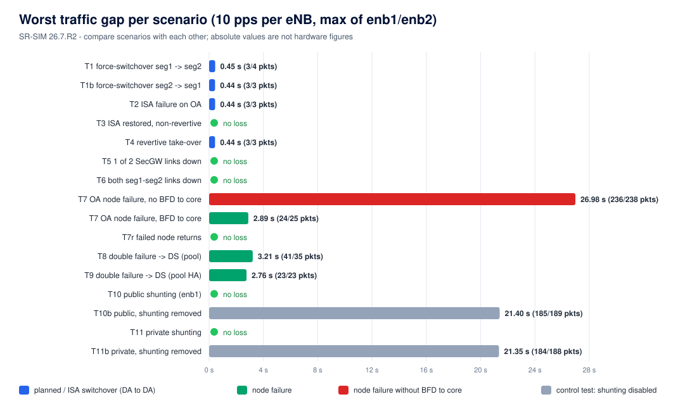

# Results — N:M MC-IPsec switchover tests

- **Run date:** 2026-10-24.
- **Software:** SR-SIM `nokia_srsim:26.7.R2`, containerlab 0.80.0, strongSwan 5.9.12.
- **Host:** WSL2, 12 vCPU, 17 GB RAM.
- **Method and pass rules:** [TEST-PLAN.md](TEST-PLAN.md).
- **Raw per-test logs and ping traces:** [`results/raw/`](results/raw).

> SR-SIM emulates the control plane and limits ports to 1000 pps. Use the numbers to compare
> scenarios with each other, not as hardware switchover times.

## 1. Summary

"Lost / worst gap" is per eNB, at 10 pps. "IKE SA kept" means the IKE SA SPI on the eNB was the same
before and after the test.

| ID | Scenario | Expected OA | Actual OA | enb1 lost / worst gap | enb2 lost / worst gap | IKE SA kept | Verdict |
|---|---|---|---|---|---|---|---|
| T0 | Baseline | seg1 | seg1 | 0 / 0.11 s | 0 / 0.11 s | yes | PASS |
| T1 | force-switchover `auto` on OA | seg2 | seg2 | 3 / 0.45 s | 4 / 0.44 s | yes | PASS |
| T1b | force-switchover to seg1 | seg1 | seg1 | 3 / 0.44 s | 3 / 0.44 s | yes | PASS |
| T2 | ISA failure on OA | seg2 | seg2 | 3 / 0.44 s | 3 / 0.44 s | yes | PASS |
| T3 | ISA restored, non-revertive | seg2 | seg2 | 0 / 0.11 s | 0 / 0.13 s | yes | PASS |
| T4 | `revertive true` on seg1 | seg1 | seg1 | 3 / 0.44 s | 3 / 0.43 s | yes | PASS |
| T5 | 1 of 2 seg1–seg2 links down | seg1 | seg1 | 0 / 0.12 s | 0 / 0.13 s | yes | PASS |
| T6 | both seg1–seg2 links down | – | seg1 | 0 / 0.11 s | 0 / 0.11 s | yes | OBSERVED |
| T7-noBFD | OA node failure, **no BFD** to core | seg2 | seg2 | 236 / 26.7 s | 238 / 27.0 s | yes | PASS (election) – see F3 |
| T7r-noBFD | failed node returns, no BFD | seg2 | seg2 | 62 / 0.23 s | 53 / 0.30 s | yes | **FAIL** – see F3 |
| T7b-noBFD | force-switchover back | seg1 | seg1 | 3 / 0.45 s | 1 / 0.22 s | yes | PASS |
| T7 | OA node failure, BFD to core | seg2 | seg2 | 24 / 2.83 s | 25 / 2.89 s | yes | PASS |
| T7r | failed node returns | seg2 | seg2 | 0 / 0.16 s | 0 / 0.15 s | yes | PASS |
| T7b | force-switchover back | seg1 | seg1 | 3 / 0.48 s | 3 / 0.45 s | yes | PASS |
| T8 | double failure → DS (pool) | seg3 | seg3 | 41 / 3.21 s | 35 / 3.03 s | yes | PASS |
| T9 | double failure → DS (pool `high-availability`) | seg3 | seg3 | 23 / 2.71 s | 23 / 2.76 s | yes | PASS |
| T10 | public shunting (ESP to standby) | seg1 | seg1 | 0 / 0.16 s | *invalid* ¹ | enb1 yes | PASS (enb1) |
| T10b | control: public shunting removed | seg1 | seg1 | 185 / 21.0 s ² | 189 / 21.4 s ² | yes | PASS (loss expected) |
| T11 | private shunting (clear text to standby) | seg1 | seg1 | 0 / 0.12 s | 0 / 0.12 s | yes | PASS |
| T11b | control: private shunting removed | seg1 | seg1 | 184 / 21.0 s ² | 188 / 21.4 s ² | yes | PASS (loss expected) |

¹ enb2's IKE SA was re-established during T10, a side effect of the sync-recovery step just before
the test (finding F4), so its T10 numbers are not used.
² The gap equals the test window: traffic does not come back while shunting is removed.

## 2. Observations per scenario

- **T0.** The state matches the guide. seg2 (DA) has 2 tunnels `Installed`, pre-loaded on its ISA;
  seg3 (DS) has 2 tunnels `Standby Dormant`, kept on its CPM.
- **T1 / T1b / T2 / T4 (DA ↔ DA switchover).**
  - About 0.44 s gap (3–4 packets), and the IKE SA is always kept, so the switchover is stateful.
  - `auto` picked seg2, not seg3, which confirms "DA is preferred over DS".
  - 22 s after T1 the core still preferred seg1 (BGP had not converged yet), but traffic was
    already flowing. The new standby shunted the ESP to the new OA.
- **T3.** seg1 came back as standby/nominal in about 70 s, with no loss. The OA stayed on seg2
  (non-revertive).
- **T4.** seg1 took the OA back 146 s after `revertive true` was committed. The commit restarts the
  domain on seg1, and seg1 then needs 60 s in standby + nominal before it may take over.
- **T5.** No loss, no switchover. The adjacency and MCS sync stayed up over link B.
- **T6.** The MIMP adjacency seg1↔seg2 stayed Up and nothing was lost. MIMP and MCS run between
  system addresses, and OSPF re-routed them through seg3.
- **T7 vs T7-noBFD.**
  - MIMP moved the OA to seg2 within about 5 s in both runs.
  - Without BFD on the core eBGP sessions, ipmpls kept the dead seg1's MED-100 route until the BGP
    hold time expired, because the links stayed up. The result was about 27 s of outage.
  - With BFD the outage was about 2.9 s.
- **T7r-noBFD.** When seg1 rebooted, its old BGP sessions were reset and the routes flapped,
  costing 53–62 packets even though seg2 stayed OA. With BFD (T7r) nothing was lost.
- **T8.** seg3 took over as `eligible`: it has no peers, so it advertises MED 200 (master without
  peer). Gap about 3.1 s.
- **T9.** With `high-availability` on the pool the gap was about 2.7 s, a modest gain over T8 in
  SR-SIM.
  - After both DAs returned, the OA stayed on seg3 (non-revertive).
  - In the earlier T8 run the OA was back on seg1 after recovery. Why this differed was not
    investigated.
- **T10 / T11 (shunting).**
  - With the core deliberately sending traffic to a standby, nothing was lost on the public side
    (enb1) or the private side (both eNBs).
  - With the shunting profile removed, about 85% of packets were lost for as long as the condition
    lasted.

## 3. Findings

**F1 — Switchovers are stateful and the election follows the documentation.**
In every switchover driven by MIMP (planned, ISA failure, node failure, double failure, revertive)
the eNB IKE SA survived. Only CHILD SAs were renewed. The order DA → DA → DS and the revertive rule
(60 s standby + nominal) behaved as documented.

**F2 — Changing `revertive` on the active node causes a switchover.**
The MD-CLI reference warns that modifying `revertive` "toggles the admin-state of the parent element".
In the lab, setting `revertive false` on the OA (seg1) took the domain down and up. seg1 went
active → notEligible → discovery, and the OA moved to seg2 without being asked to. Change `revertive`
only on standby nodes, or in a maintenance window.

**F3 — BFD on the SecGW–core routing is essential.**
MIMP detects node failure quickly, but traffic follows routing. Without BFD, a dead node whose links
stay up keeps attracting traffic for the BGP hold time (about 27 s in T7-noBFD), and its return
causes another hit (T7r-noBFD). With BFD on the eBGP sessions the outage dropped to about 2.9 s.

**F4 — Protection status can stay `notReady` long after a switchover.**
- After every switchover the protection status was `notReady` for about 30 s to 2.5 min. The guide
  says: "pending IPsec states which need to be synced". During that time a new switchover is not
  recommended.
- After a double failure, when the DAs returned and the OA was switched back from the DS to seg1,
  the status stayed `notReady` on all three nodes for **more than 6–15 minutes**. MCS still showed
  `inSync` with equal entry counts, and a manual CHILD_SA rekey did not help.
- Disabling and re-enabling `peer <x> mc-ipsec domain 1` on all peers cleared it in about 20 s.
  The SR OS release notes document this as the recovery for an older, resolved N:M sync issue with
  (re)joining standby nodes.
- The runner needed this recovery twice in the final runs (`results/raw/workarounds.log`). It was not
  established whether this is SR-SIM behaviour or also affects hardware. **Check on hardware before
  relying on it.**

**F5 — Path diversity of the full mesh.**
Because MIMP and MCS run between system addresses over an IGP, losing both direct links between two
nodes was absorbed by the third node with no impact (T6). The deployment guide still asks for
dedicated, redundant, direct links. This is an extra safety net, not a replacement.

**F6 — Shunting is needed.**
Shunting is what keeps traffic flowing while routing converges after a switchover (T1), and whenever
the core still points to a standby (T10, T11). Without it, everything that lands on a non-OA node is
dropped (T10b, T11b).

**F7 — Configuration details found while building the lab** (SR OS 26.7):
- `isa-scale-mode` is mandatory on the tunnel group.
- A private IPsec tunnel interface cannot have a primary IPv4 address.
- Dynamic LAN-to-LAN tunnels on an `ipsec-gw` need `sp-reverse-route use-security-policy` in the
  tunnel template.
- eBGP needs explicit import and export policies (`ebgp-default-reject-policy`).
- Each SR-7 SR-SIM node needs about 1.8 GB of RAM (CPM + IOM container).

## 4. Validity of the data

The runs below were discarded and are not in the table. Their causes were fixed in the runner.

| Run | Reason |
|---|---|
| T5 first attempt | it started while protection was still `notReady` after F2; kept as `T5-attempt1` in raw |
| T7–T9, first pass | two runner instances ran at the same time and killed nodes for each other; a lock now prevents this |
| T9, first pass | it started from `notReady` (F4) and before BGP had converged; the runner now waits for both |
| T10/T11, first pass | an MD-CLI context error meant the core policy was not created; `exit all` added before commit |

Timestamps in `results/raw/*.md` are host local time (UTC+2). SR OS log events are in UTC.
