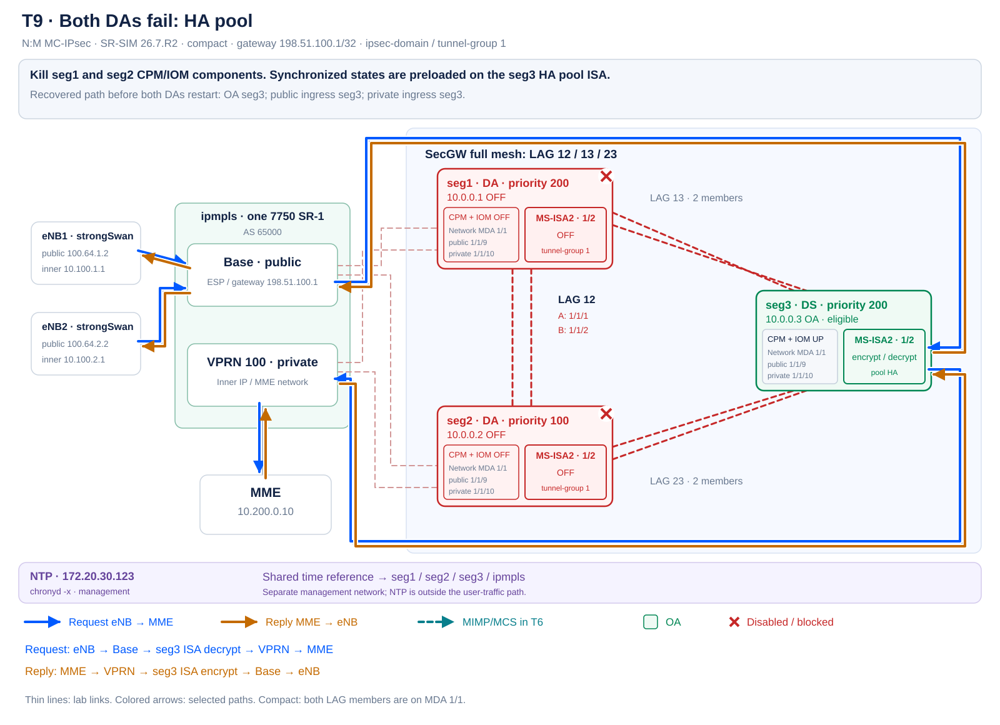

# N:M MC-IPsec validation results

**Test dates: 24–25 October 2026.** The compact-profile program is complete:
all 23 accepted measurement windows meet their functional criteria. Coverage includes
stateful DA switchover, normal/HA DS takeover, node return, public/private shunting and
forwarding over a surviving LAG member.

The [customer test program](docs/TEST-PROGRAM.md) describes each action, both traffic
directions, acceptance and restoration. The [per-test topology gallery](docs/TOPOLOGY-TESTS.md)
shows the complete lab, disabled components and traffic arrows for every window.

## Validated environment

| Parameter | Value |
|---|---|
| SR OS | SR-SIM 26.7.R2 |
| Orchestrator | containerlab 0.80.0 |
| SecGWs | Three 7750 SR-7s; CPM5, one IOM4-e and one MS-ISA2 per node |
| Roles | seg1 DA priority 200; seg2 DA priority 100; seg3 DS priority 200 |
| Core | One 7750 SR-1: public Base and private VPRN 100 |
| Initiators | Two Linux eNBs; strongSwan 5.9.12; IKEv2/ESP |
| Probe traffic | Configured 10 ICMP echo requests/s per eNB inner address to 10.200.0.10 |
| Inter-node links | LAG 12/13/23, two LACP members each; VLAN 1 public/control, VLAN 3 private |
| Time | Shared NTP 172.20.30.123 over management; chronyd -x, local stratum 10 |
| Runtime | WSL2, 12 logical CPUs, 17.15 GiB RAM, 5 GiB swap |
| Host | Intel i5-1245U, 32 GiB RAM |

The program ran in sequential groups. The table consolidates the final accepted measurements
for each scenario; their source groups are identified under Evidence. This is functional
validation of two tunnels. Numerical gaps apply to this SR-SIM instance; hardware SLA
thresholds and load-test parameters are agreed separately.

## Accepted measurements

Each eNB column gives lost packets and the maximum interval without a reply.
The test identifier links to its measurement log.

| Window | OA after | IKE kept | eNB1: lost / max gap | eNB2: lost / max gap | Verdict |
|---|---|---|---|---|---|
| [T0](results/validated-compact-20261025-072430/T0.log) | seg1 | yes | 0 / 0.103 s | 0 / 0.103 s | PASS |
| [T1](results/validated-compact-20261024-212054/T1.log) | seg2 | yes | 3 / 0.440 s | 3 / 0.440 s | PASS |
| [T1b](results/validated-compact-20261024-212054/T1b.log) | seg1 | yes | 3 / 0.440 s | 3 / 0.443 s | PASS |
| [T2](results/validated-compact-20261024-212948/T2.log) | seg2 | yes | 3 / 0.436 s | 3 / 0.461 s | PASS |
| [T3](results/validated-compact-20261024-212948/T3.log) | seg2 | yes | 0 / 0.161 s | 0 / 0.184 s | PASS |
| [T4](results/validated-compact-20261024-212948/T4.log) | seg1 | yes | 3 / 0.426 s | 3 / 0.431 s | PASS |
| [T5](results/validated-compact-20261024-212948/T5.log) | seg1 | yes | 0 / 0.119 s | 0 / 0.134 s | PASS |
| [T6](results/validated-compact-20261024-212948/T6.log) | seg1 | yes | 0 / 0.107 s | 0 / 0.109 s | PASS |
| [T7](results/validated-compact-20261024-212948/T7.log) | seg2 | yes | 25 / 2.947 s | 25 / 2.953 s | PASS |
| [T7-noBFD](results/validated-compact-20261024-212948/T7-noBFD.log) | seg2 | yes | 744 / 84.238 s | 742 / 84.187 s | PASS |
| [T8](results/validated-compact-20261024-215807/T8.log) | seg3 | yes | 25 / 2.948 s | 26 / 3.033 s | PASS |
| [T8r](results/validated-compact-20261024-215807/T8r.log) | seg3 | yes | 0 / 0.184 s | 0 / 0.154 s | PASS |
| [T9](results/validated-compact-20261025-072430/T9.log) | seg3 | yes | 24 / 2.811 s | 22 / 2.602 s | PASS |
| [T9r](results/validated-compact-20261025-072430/T9r.log) | seg3 | yes | 0 / 0.105 s | 0 / 0.105 s | PASS |
| [T10-seg2](results/validated-compact-20261025-070431/T10-seg2.log) | seg1 | yes | 0 / 0.104 s | 0 / 0.103 s | PASS |
| [T10b-seg2](results/validated-compact-20261025-070431/T10b-seg2.log) | seg1 | yes | 93 / 10.534 s — blocked | 95 / 10.843 s — blocked | PASS |
| [T10-seg3](results/validated-compact-20261025-070431/T10-seg3.log) | seg1 | yes | 0 / 0.104 s | 0 / 0.104 s | PASS |
| [T10b-seg3](results/validated-compact-20261025-070431/T10b-seg3.log) | seg1 | yes | 92 / 10.507 s — blocked | 96 / 10.827 s — blocked | PASS |
| [T11-seg2](results/validated-compact-20261025-070431/T11-seg2.log) | seg1 | yes | 0 / 0.103 s | 0 / 0.104 s | PASS |
| [T11b-seg2](results/validated-compact-20261025-070431/T11b-seg2.log) | seg1 | yes | 93 / 10.582 s — blocked | 95 / 10.800 s — blocked | PASS |
| [T11-seg3](results/validated-compact-20261025-070431/T11-seg3.log) | seg1 | yes | 0 / 0.118 s | 0 / 0.105 s | PASS |
| [T11b-seg3](results/validated-compact-20261025-070431/T11b-seg3.log) | seg1 | yes | 92 / 10.558 s — blocked | 94 / 10.793 s — blocked | PASS |
| [T12](results/validated-compact-20261025-070431/T12.log) | seg2 | yes | 1 / 0.205 s | 2 / 0.314 s | PASS |

Every accepted window preserved both original IKE SAs: both SPI values of each session were
checked before and after the action. CHILD SAs were installed; CHILD rekey on switchover
was allowed. Ownership checks examine the domain, including an isolated DS in eligible state.

The gap includes the window head, inter-reply intervals and the tail after the final reply.
Even a no-loss 10-pps stream has normal intervals near 0.1 s. This is an ICMP observation
including host scheduling, rather than exact hardware forwarding downtime.

In T10b/T11b, blocking after profile removal is the **expected negative-control result**.
The window includes successful baseline replies before the action. After profile removal,
both flows remain blocked through the end of observation. That gap bounds the observed
blockage; it is not recovery time. The profile is restored after the control window ends.

## Verified behavior

### DA switchover and ISA return

T1/T1b demonstrate controlled seg1 → seg2 → seg1 switchover while preserving IKE.
Disabling the active ISA in T2 transfers ownership to seg2. Restoring the ISA in T3 leaves
seg2 as OA under non-revertive operation, without packet loss.

T4 demonstrates automatic return to the preferred DA with revertive enabled. The
[election event log](results/validated-compact-20261024-212948/T4-election-events.log)
records nominal at 19:33:31.290 UTC and takeover at 19:35:32.265 UTC, approximately 121 s
later. Nokia's 60-s standby/nominal condition is a minimum eligibility interval. The role-return
wait and the short user-traffic gap are separate measurements.

### Link resilience

T5 retains OA and traffic when one LAG member fails. T6 disables both direct LAG 12 members:
MIMP/MCS remains reachable through seg3, all participants stay nominal and user traffic
continues without loss. The [control-underlay route](results/validated-compact-20261024-212948/T6-underlay-evidence.log)
is recorded separately.

Both members are on one network MDA in compact. T5/T6/T12 therefore validate port/link
failures. The [dual-IOM reference topology](profiles/dual-iom.clab.yml) places members on
different IOMs for a separate component-redundancy program.

### OA failure and core BFD

In T7, seg1 CPM/IOM components are killed. Traffic recovers through seg2 **before seg1
restarts**. Returning seg1 adds no missing sequence numbers and preserves IKE.

T7-noBFD is a separate control with BFD disabled only on core BGP peerings. The core retains
the failed OA next-hop until BGP hold expiration; the negotiated hold time is 90 s. See the
[route and BGP evidence](results/validated-compact-20261024-212948/T7-noBFD-stale-core-route.log).
Traffic also recovers before seg1 startup in this variant, and node return adds no loss.
The normal lab configuration enables BFD.

### DS takeover and pool HA

T8 and T9 recover both flows on seg3 after both DAs are killed, preserving IKE and before
the DAs return. T8 uses a normal pool; T9 uses `high-availability tunnel-limit-32k`.
The user-packet processing path is the same:

Normal mode downloads states from CPM to ISA at takeover. HA preloads them on the pool ISA;
takeover still requires activation. The measured gaps also include fault detection and route
convergence. One observation per mode on two tunnels does not establish a statistical HA
performance advantage.

T8r/T9r separately measure both DAs returning. In both accepted measurements, seg3 remains
OA, all participants reach nominal, both IKE pairs survive and neither eNB loses packets.
Each eNB receives all 933 replies in the final T9r window.

HA preparation is completed before the measured fault, as specified in the
[operational conditions](docs/operational-notes.md). The group ends with OA seg1 and
normal pool mode none.

### Shunting through both standbys

For T10/T11, the core selects the relevant routes through seg2 and then seg3. All four
positive windows pass without loss. Removing the corresponding profile in four negative
controls blocks both round-trip flows while preserving OA and IKE.

T12 combines member-A failure, switchover to OA seg2 and both traffic paths pinned through
former OA seg1. Its final stable part demonstrates shunting on surviving member B:

## Evidence

| Measurement group | Accepted windows |
|---|---|
| [24 October, group 1](results/validated-compact-20261024-212054/) | T1, T1b |
| [24 October, group 2](results/validated-compact-20261024-212948/) | T2, T3, T4, T5, T6, T7, T7-noBFD |
| [24 October, group 3](results/validated-compact-20261024-215807/) | T8, T8r |
| [25 October, shunting](results/validated-compact-20261025-070431/) | Four public, four private windows, and T12 |
| [25 October, final group](results/validated-compact-20261025-072430/) | T9, T9r, T0 |

Each directory contains the accepted windows listed for that group: original log lines
from window start through the after-action snapshot, complete START/STOP ping traces,
JSON metrics and source-invocation metadata. These results are not presented as one
uninterrupted `all` invocation. All **46 original ping traces** were independently reparsed
and matched to their stored metrics. T7/T7-noBFD were also checked for additional missing
sequences during node return.

Index: [validated-compact-index.json](results/validated-compact-index.json).
Checksums: [validated-evidence-sha256.json](results/validated-evidence-sha256.json).
Group names use WSL local time; SR OS event timestamps are explicitly marked UTC, and ping
uses Unix timestamps. Retain those time references when correlating evidence.

## Final operational state

Operational acceptance passed: OA seg1, one agreed Current Active, nominal protection on
all SecGWs, MCS inSync, both IKE/CHILD sessions installed and two installed tunnels on OA.
The gateway and private routes use seg1. ISAs and both members of every LAG are operational;
shunting is restored, BFD enabled, revertive false and pool mode none. Shared NTP is selected
on all four routers. Temporary neighbor route pins are removed and configurations saved.

Full protocol: [operational.log](results/validated-final-state/operational.log).
The scenarios and configuration were checked against the
[Nokia SR OS 26.7 IP tunnels guide](https://documentation.nokia.com/sr/26-7/7750-sr/books/ms-isa-esa/ip-tunnels.html)
and the command references listed in the [test program](docs/TEST-PROGRAM.md).
