# Программа испытаний N:M MC-IPsec на Nokia SR OS

Этот документ описывает воспроизводимые функциональные испытания трёхузлового SecGW на
SR-SIM 26.7.R2. Для каждого сценария указаны исходное состояние, отключаемый компонент,
ожидаемые роли и маршруты, путь пакета в обоих направлениях, критерии оценки и восстановление.
Фактические измерения и условия их применения приведены в [RESULTS.md](../RESULTS.md).
Каждому принятому окну соответствуют исходные журналы и ping-трассы.

Программа проверяет stateful switchover, восстановление и shunting для двух IPsec-туннелей.
Метрики SR-SIM относятся к данной лаборатории. Для аппаратных приёмочных испытаний нагрузка,
масштаб и численные пороги SLA согласуются отдельно.

## Стенд и роли узлов


| Узел | Назначение | Designated role | Приоритет | System address |
|---|---|---|---|---|
| seg1 | Предпочтительный SecGW | DA | 200 | 10.0.0.1 |
| seg2 | Второй SecGW с заранее установленными состояниями на ISA | DA | 100 | 10.0.0.2 |
| seg3 | Резервный SecGW с ISA tunnel-member-pool | DS | 200 | 10.0.0.3 |
| ipmpls | Общий маршрутизатор public и private сторон | — | — | См. topology/configs |
| enb1 и enb2 | Инициаторы IKEv2 и источники пользовательского трафика | — | — | См. таблицу адресов |
| mme | Получатель внутреннего трафика и источник ответов | — | — | 10.200.0.10 |
| ntp | Общая лабораторная опора времени | — | — | management 172.20.30.123 |

DA и DS — заданные роли, OA — текущий operational active. Наличие двух DA не означает,
что оба одновременно обрабатывают трафик одного домена. В штатном состоянии ровно один
узел является OA. В изоляции единственный выживший узел может иметь Activity State `eligible`
и локально выполнять функции OA. Поэтому проверяется весь набор узлов, а не первый найденный
ответ со словом active. После восстановления связности все участники должны согласовать
один Current Active и вернуться в `nominal`.

Домен `ipsec-domain 1` связан с `tunnel-group 1`, `active-isa-number 1`. На DA ISA 1/2
привязана непосредственно к tunnel-group. На DS tunnel-group использует `pool1`.
В обычном pool синхронизированные состояния хранятся на CPM и загружаются на ISA при takeover.
В HA pool состояния заранее загружаются на ISA; при takeover их ещё требуется активировать.

| Объект | Значение |
|---|---|
| Public IP eNB1 / eNB2 | 100.64.1.2 / 100.64.2.2 |
| Inner IP eNB1 / eNB2 | 10.100.1.1/32 / 10.100.2.1/32 |
| Общий адрес IPsec gateway | 198.51.100.1/32 на каждом SecGW |
| Внутренняя сеть MME | 10.200.0.0/24, тестовый узел 10.200.0.10 |
| Public routing instance | Base на SecGW и ipmpls |
| Private routing instance | VPRN 100, имя mobile |
| Core AS / SecGW AS | 65000 / 64512 |
| BGP MED OA с peer / OA без peer / standby | 100 / 200 / 1000 |
| IKE на SecGW / eNB | 172800 / 86400 с |
| CHILD на SecGW / eNB | 7200 / 3600 с |
| DPD на SecGW | reply-only; eNB инициирует проверки |

Изображение каждого сценария показывает логические этапы обработки пакета. Прямоугольники
`ipmpls Base` и `ipmpls VPRN` обозначают разные routing instances одного физического узла.
Они не являются двумя отдельными core-маршрутизаторами. Синяя стрелка — путь пакета,
зелёный SecGW — OA, серый — standby, красный — отключённый компонент или заблокированный путь.
На схеме eNB указан его inner address; наружный ESP использует public address из таблицы.

## Избыточность связей

Каждая пара SecGW соединена LACP LAG с двумя участниками. VLAN 1 несёт control/public
связность и public shunting; VLAN 3 используется для private shunting. MIMP/MCS работает
между system addresses через OSPF. При потере прямого LAG 12 control traffic может обойти
через seg3 по LAG 13 и LAG 23. Shunting на конкретного peer использует настроенный прямой
peer next-hop; наличие обходного control-маршрута не заменяет проверку shunting data path.

| LAG | Сторона A | Сторона B | Пара портов в compact |
|---|---|---|---|
| 12 | seg1 | seg2 | 1/1/1 и 1/1/2 на обоих узлах |
| 13 | seg1 | seg3 | seg1 1/1/3 и 1/1/4; seg3 1/1/1 и 1/1/2 |
| 23 | seg2 | seg3 | 1/1/3 и 1/1/4 на обоих узлах |

Compact имеет один IOM и обе линии каждой пары на одной MDA. Испытания T5/T6/T12 в этом
профиле проверяют отказ портов/линий. Они не доказывают устойчивость к отказу целого IOM/MDA.
В [двух-IOM профиле](../profiles/dual-iom.clab.yml) участник B переносится на IOM 2:
1/1/2 → 2/1/1, 1/1/4 → 2/1/3. Для него сначала выполняется
`python3 gen_configs.py --dual-iom`, затем применяется соответствующая topology и
`TOPOLOGY=profiles/dual-iom.clab.yml`. Для возврата к compact конфигурации генерируются заново
без `--dual-iom`. Оба профиля не следует одновременно развёртывать в одной management-сети.

## Обычный путь пользовательского трафика

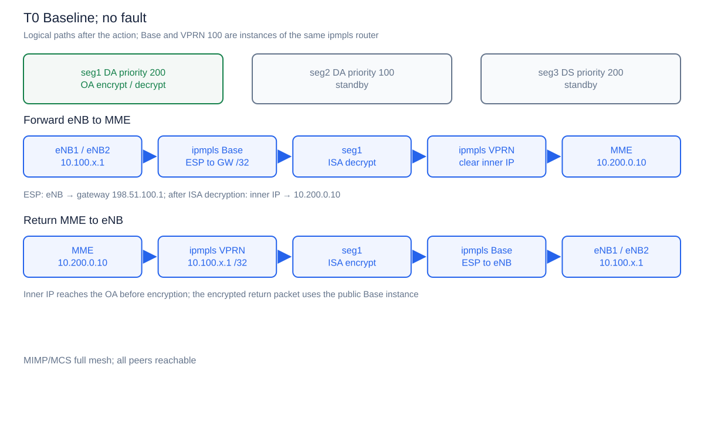

Запрос от enb1 имеет внутренний IP source 10.100.1.1 и destination 10.200.0.10. StrongSwan
шифрует пакет. Core в Base выбирает маршрут 198.51.100.1/32 к OA. Активная ISA расшифровывает
ESP, после чего внутренний пакет проходит через private VPRN к MME. Для enb2 путь аналогичен.

Ответ MME имеет destination 10.100.x.1. Core в VPRN 100 выбирает соответствующий /32 к OA.
Активная ISA шифрует пакет, а public Base доставляет ESP к 100.64.x.2. Поэтому отдельно
проверяются gateway /32 и оба private /32. Верная public-маршрутизация сама по себе не
доказывает исправность обратного направления.

При public shunting ESP сначала попадает на standby и пересылается к OA без расшифрования
на standby. При private shunting внутренний пакет сначала попадает на standby в VPRN,
затем пересылается к OA, где выполняется шифрование. В T10/T11 эти механизмы изолируются
раздельным закреплением маршрутов. В T12 оба используются одновременно.

## Общая методика измерения

Перед независимым сценарием runner требует отвечающие CLI, единственный OA, согласованный
Current Active, nominal на всех трёх узлах, оба туннеля на OA, существующие IKE/CHILD SA
на обоих eNB и ожидаемые маршруты core. На каждом SecGW дополнительно должны быть BGP
маршруты к 100.64.1.0/24, 100.64.2.0/24 и 10.200.0.0/24. Это исключает начало опыта,
когда MC-IPsec уже готов, но forwarding-маршруты после загрузки ещё отсутствуют.

Подготовительные ping выполняются вне измеряемого окна: до 90 секунд повторяются серии
по 20 пакетов, пока оба eNB не получат 20/20. SA до/после сохраняются. Подготовка не
сбрасывает IKE или peer-domain. Затем отдельно проверяется nominal. Условия ресурсов
и обслуживания описаны в [операционных примечаниях](operational-notes.md).

Измерение использует на каждом eNB:

```bash
ping -n -D -O -i 0.1 -W 1 -I 10.100.1.1 10.200.0.10
ping -n -D -O -i 0.1 -W 1 -I 10.100.2.1 10.200.0.10
```

До отказа требуется не менее десяти последовательных ответов без начальных пропущенных
номеров. START/STOP записываются внутри контейнера источника. Gap учитывает начало окна,
интервалы между ответами и хвост после последнего ответа. Это интервал без наблюдённого
ответа, а не точная длительность потери forwarding. Даже при нулевых потерях gap около
0,1 с нормален для 10 pps. Планировщик хоста добавляет погрешность.

Восстановление означает десять последовательных ответов с недавним последним ответом;
для текущего действия все десять должны быть новее этого действия. Outstanding-notice `-O`
не считается окончательной потерей, если ответ с тем же sequence number позднее получен.
Потери в завершённом измерении берутся из transmitted/received, а исходные sequence numbers
используются также для отдельной проверки возврата узлов.

На обоих eNB фиксируются **два SPI каждой IKE SA** до и после опыта. Они должны быть
непустыми и неизменными, CHILD SA должна быть INSTALLED. Смена CHILD SA при переключении
ожидаема: Nokia описывает CHILD rekey для сброса ESP sequence number. Требовать неизменный
CHILD SPI означало бы проверять неверное условие. Смена или пересоздание IKE SA не
засчитывается как stateful switchover.

| Класс проверки | Дополнительное условие |
|---|---|
| Stateful failover | Ожидаемый единственный OA, обе IKE сохранены, оба потока восстановились |
| No loss | Всё перечисленное и ноль потерь на каждом eNB |
| Negative shunting control | IKE сохранены, OA не изменился, оба потока теряются и не восстановлены к концу окна |
| Возврат seg1 в T7 | Нет новых отсутствующих sequence numbers после начала запуска узла |
| Возврат DA в T8r/T9r | Единственный OA, nominal, IKE сохранены; ноль потерь, если OA остаётся seg3 |

Для failover в этой программе не установлен численный аппаратный порог gap. PASS означает
выполнение функциональных условий, а измеренное время публикуется отдельно. Negative control
с unrecovered tail — успешное доказательство блокировки, но **не** измеренное время восстановления.
Ошибка CLI/SSH, неподготовленный стенд или timeout останавливают серию с ненулевым exit code
и диагностикой; readiness записывается INVALID. Это не должно превращаться в PASS по факту
запуска команды. Удалённый отказ и восстановление не отменяют уже записанный FAIL.

## Запуск и доказательная база

```bash
python3 -m unittest discover -s tests -v
./tests/nm_tests.sh all
# Либо независимые группы; T3 выполняется внутри T2, T1b внутри T1
./tests/nm_tests.sh T0 T1 T2 T4 T5 T6
./tests/nm_tests.sh T7 T7-noBFD T8 T9 T10 T11 T12
```

Полный набор — 23 измеряемых окна: T0, T1, T1b, T2, T3, T4, T5, T6, T7, T7-noBFD,
T8, T8r, T9, T9r, по четыре окна public/private shunting через seg2/seg3 и T12.
Каждый запуск создаёт отдельный `results/YYYYMMDD-HHMMSS/` с metadata и SHA-256 runner,
пошаговыми логами, исходными `.ping`, JSON и SUMMARY. Публикуемые принятые данные
находятся в `results/validated-*`; выбор принятых строк и повторы объяснены в RESULTS.md.

В командах ниже имя лаборатории по умолчанию — `nm-mc-ipsec`. Реальное имя берётся из
topology; в рабочем WSL экземпляре использовалось `tmo-secgw-nm`. Команды `/configure ...`
даны как MD-CLI изменения для private candidate с последующим commit. Для ручного
применения можно сохранить snippet и использовать `./apply_cfg.sh snippet.cfg seg1`.
Инъекции отказов в автоматической программе выполняет runner; одновременно вручную
менять тот же стенд или запускать второй runner нельзя.

Основные команды наблюдения:

```bash
./sros.sh seg1 'show redundancy multi-chassis ipsec-domain 1'
./sros.sh seg1 'show redundancy multi-chassis sync'
./sros.sh seg1 'show isa tunnel-group'
./sros.sh seg1 'show ipsec gateway name "enb-gw" tunnel'
./sros.sh seg1 'show lag'
./sros.sh seg1 'show mda'
./sros.sh seg1 'show system ntp all'
./sros.sh ipmpls 'show router route-table 198.51.100.1/32'
./sros.sh ipmpls 'show router "100" route-table 10.100.1.1/32'
./sros.sh ipmpls 'show router "100" route-table 10.100.2.1/32'
docker exec clab-nm-mc-ipsec-enb1 swanctl --list-sas
docker exec clab-nm-mc-ipsec-enb2 swanctl --list-sas
```

## Сценарии испытаний

### T0 Базовая передача трафика

**Цель.** Подтвердить исправность стенда до внесения отказов и получить контрольный уровень
потерь и интервалов между ответами. OA — seg1; seg2 и seg3 standby; все nominal.

**Действие.** Ничего не отключаем. После стабильного начала держим измерение ещё 10 секунд.
На обоих направлениях используется обычный путь через ISA seg1, показанный выше.

**Оценка.** Ноль потерь на обоих eNB, те же обе IKE SA, CHILD INSTALLED, единственный OA seg1.
Если этот опыт не проходит, тесты переключений начинать нельзя: сначала требуется устранить
неисправность базового пути. Восстановление конфигурации для T0 не требуется.

### T1 и T1b Управляемое переключение между DA

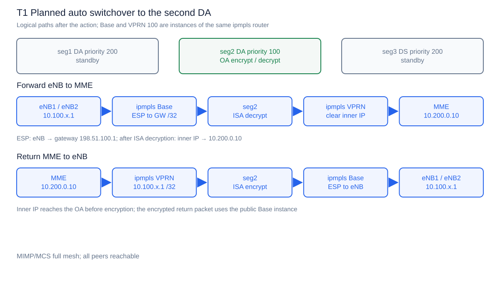

**Исходное состояние.** T1 начинается на seg1, весь домен nominal. Приоритет seg2 ниже,
но он DA; seg3 — DS. На целевом seg2 заранее проверяются forwarding-маршруты.

**Действие T1.** На текущем OA выполняется:

```text
tools perform redundancy multi-chassis mc-ipsec force-switchover domain 1 auto now
```

Ожидается выбор seg2 как другого DA перед DS. Core должен перенести gateway /32 и оба
private /32 на seg2. После сходимости запросы и ответы идут через ISA seg2. Сохраняются
обе IKE; CHILD rekey допускается и ожидается. Измерение продолжается до устойчивого ответа
на обоих eNB. Потери переключения включаются в измеряемое окно.

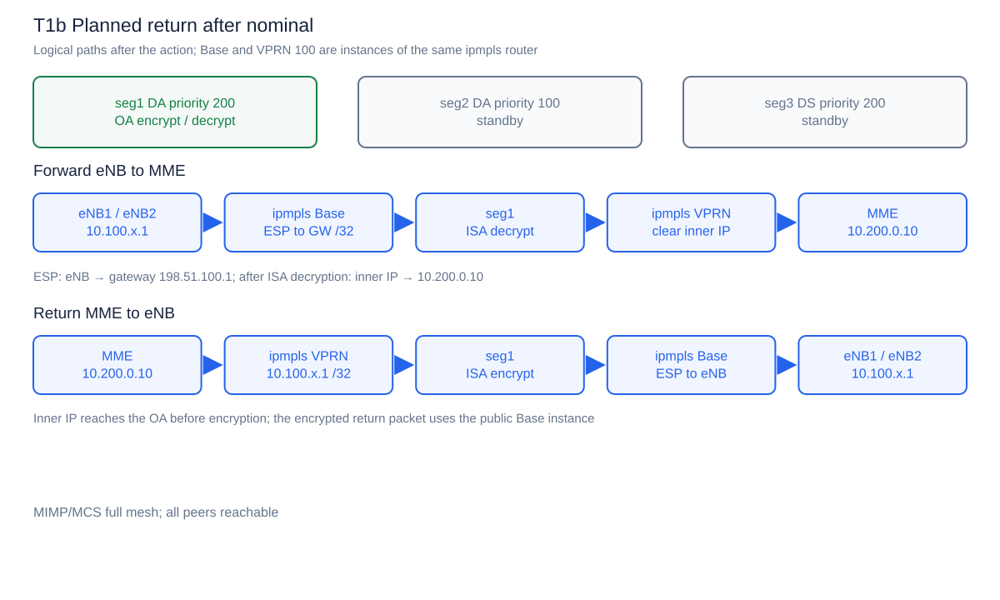

**Действие T1b.** До обратного переключения обязательно дождаться nominal на всех узлах.
На seg2 выполнить явное переключение:

```text
tools perform redundancy multi-chassis mc-ipsec force-switchover domain 1 to 10.0.0.1 now
```

Проверяются тот же набор условий, OA seg1 и возврат всех трёх /32 через seg1. T1b не
начинается сразу после первого успешного ping, если Protection Status ещё notReady.
Следующий плановый сценарий запускается после восстановления полного nominal baseline.

### T2 Отказ активной ISA

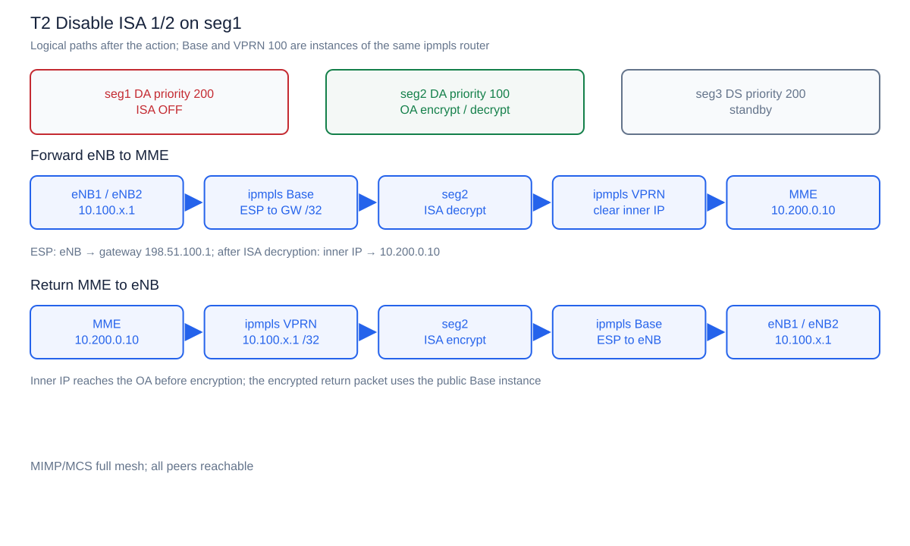

**Исходное состояние.** OA seg1, обе IKE установлены, домен nominal. CPM и сетевые порты
seg1 исправны. Этот опыт изолирует отказ ISA от отказа всего шасси.

**Действие.** Отключить ISA MDA на seg1 и commit:

```text
/configure card 1 mda 2 admin-state disable
```

Seg1 теряет право быть OA, ожидается seg2. После сходимости public ESP и private возврат
идут через seg2; обе IKE сохраняются. Требуется наблюдать восстановление трафика **до**
включения ISA seg1. Иначе восстановление неисправного компонента могло бы замаскировать
неработающий резервный путь. Фиксируются MIMP activity/protection, число installed tunnels,
маршруты core, gap и потери каждого eNB. ISA остаётся отключённой для отдельного T3.

### T3 Возврат ISA без revertive

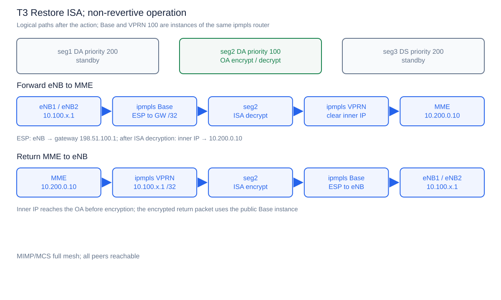

**Исходное состояние.** Продолжение T2: OA seg2, seg1 ISA выключена; nominal ещё не требуется,
поскольку цель опыта — восстановление отсутствующего компонента. Маршруты должны уже идти
через seg2 и трафик должен быть стабильным. `revertive false`.

**Действие.** Начать новое измеряемое окно и включить ISA:

```text
/configure card 1 mda 2 admin-state enable
```

Дождаться nominal на всех участниках, затем ещё 10 секунд наблюдать трафик. Seg1 должен
вернуться в standby, seg2 остаться OA. Поток не меняет рабочую ISA. Критерий — ноль потерь,
обе прежние IKE и nominal. Более высокий priority seg1 сам по себе не должен вызывать
немедленный возврат роли при non-revertive. Перед следующей независимой группой runner
возвращает установленный для неё baseline управляемым переключением вне её окна.

### T4 Автоматический revertive возврат

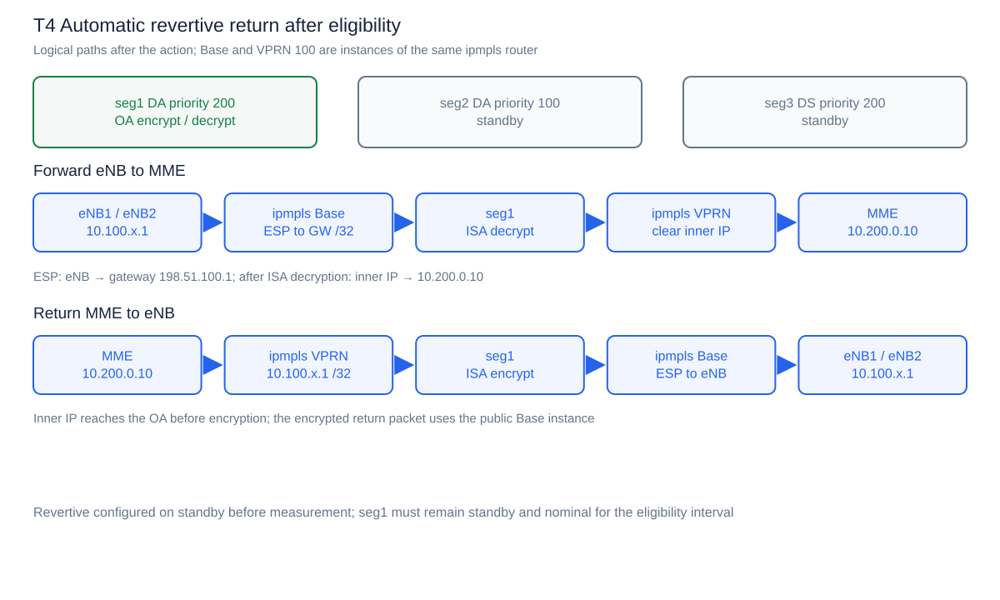

**Подготовка.** Seg2 OA и весь домен nominal. На standby seg1 отключить ISA и включить
revertive в одном подготовительном изменении. Изменение revertive не входит в измеряемое
окно: Nokia предупреждает, что оно переключает admin-state домена. Менять его на текущем
OA означало бы смешать проверку revertive с административным сбросом активного домена.

```text
/configure card 1 mda 2 admin-state disable
/configure redundancy multi-chassis ipsec-domain 1 revertive true
```

**Действие.** Начать стабильный ping через seg2, включить ISA seg1. Дальше вручную
force-switchover не выполнять. Seg1 должен стать standby, затем nominal и выдержать
документированные условия eligibility. Nokia указывает непрерывные 60 секунд standby
и nominal; это не следует трактовать как обещание ровно 60 секунд от включения ISA.
По событийному журналу отдельно фиксируются моменты standby, nominal и автоматического active.

**Оценка.** OA автоматически становится seg1, core /32 сходятся на seg1, обе IKE сохраняются,
оба потока восстановлены. Время ожидания takeover и gap пользовательского трафика публикуются
как разные величины. Для очистки дождаться nominal, перевести OA на seg2, выключить revertive
на standby seg1 и снова подготовить штатный baseline. Наличие ручного переключения вместо
автоматического takeover не засчитывается как PASS T4.

### T5 Отказ одного участника LAG

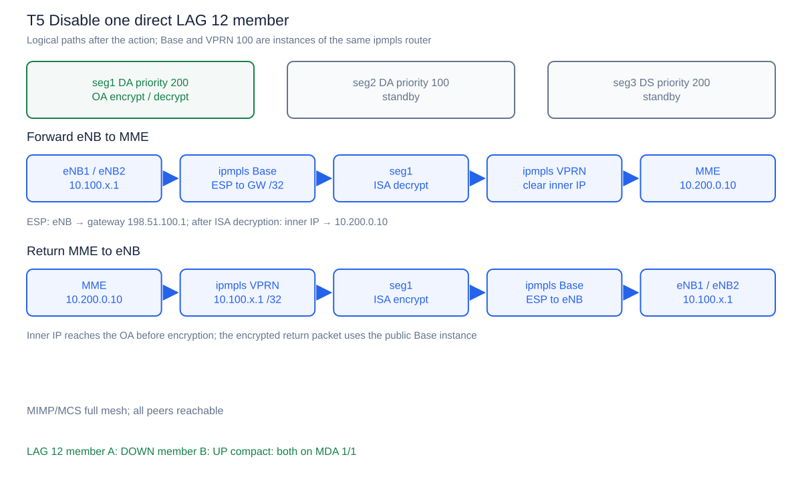

**Исходное состояние.** OA seg1, nominal, оба участника LAG 12 работают. **Действие:**

```text
/configure port 1/1/1 admin-state disable
```

После commit наблюдать ещё 15 секунд. Отключается только member A на seg1; member B
должен сохранить связность. Ожидается прежний путь eNB → core Base → seg1 ISA → private
core → MME и обратный путь через ту же ISA. OA меняться не должен, потери недопустимы.
Снять `show lag 12 detail`, при необходимости `show port 1/1/2`, состояние domain/MCS.
LAG должен иметь одного рабочего участника. Восстановить `port 1/1/1 admin-state enable`.
Этот опыт не доказывает фактическое прохождение shunted data по member B: это отдельно делает T12.

### T6 Отказ обеих прямых линий между seg1 и seg2

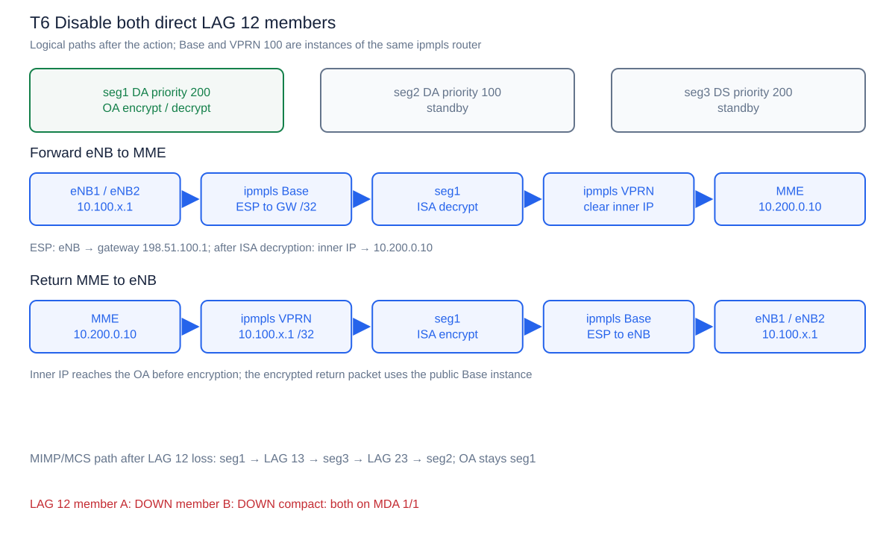

**Действие.** В nominal baseline seg1 отключить оба участника LAG 12 на seg1:

```text
/configure port 1/1/1 admin-state disable
/configure port 1/1/2 admin-state disable
```

Для dual-IOM второй порт — 2/1/1. После commit наблюдать 20 секунд. Прямой LAG 12 должен
стать down. OSPF должен сохранить достижимость system addresses обходом seg1 → LAG 13 →
seg3 → LAG 23 → seg2. В compact маршруте seg1 до 10.0.0.2/32 ожидается next-hop 10.13.1.1.
MIMP/MCS должны сохранить согласование, OA seg1 и protection nominal.

Пользовательский поток при этом по-прежнему проходит ISA seg1 и не обязан проходить seg3.
На рисунке control path указан отдельно. Требуется ноль потерь на обоих eNB, те же IKE и
nominal. Если nominal потерян, одной успешной передачи ping для PASS недостаточно.
Восстановить оба порта, убедиться в двух up-members LAG 12 и штатном прямом маршруте.

### T7 Полный отказ OA с BFD до core

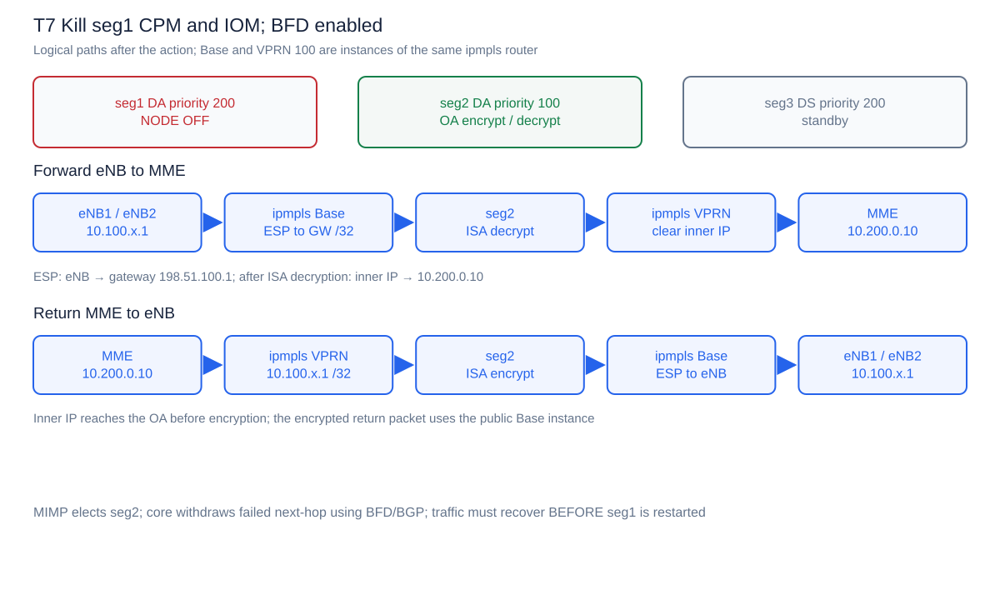

**Исходное состояние.** OA seg1, nominal, BFD включён на Base и VPRN BGP group core/segw
с обеих сторон. MIMP/MCS соединения между SecGW сохраняют собственные настройки BFD.

**Действие.** Остановить CPM и все IOM компоненты seg1. В compact:

```bash
docker kill clab-nm-mc-ipsec-seg1-1 clab-nm-mc-ipsec-seg1-a
```

В dual-IOM добавляется `clab-nm-mc-ipsec-seg1-2`. Это отказ всего моделируемого SecGW,
а не только ISA. Containers netns и остальные узлы не останавливаются. Seg2 должен стать
единственным OA; core должен убрать next-hop неисправного узла и выбрать seg2 в Base и VPRN.
После этого оба направления работают через ISA seg2.

**Порядок оценки.** Сначала дождаться десяти последовательных новых ответов обоих eNB,
пока seg1 остаётся выключенным. Снять domain, core routes и обе IKE. Только затем отметить
`NODE RETURN WINDOW START` и запустить компоненты seg1. Ping всё время продолжает работать.
Дождаться CLI seg1, nominal на всех узлах и стабильного трафика. Между последним sequence
перед запуском и последним ответом после nominal не должно быть новых пропусков.

**Оценка.** OA seg2, обе IKE прежние, первоначальный outage завершился до запуска seg1,
возврат узла не добавил потерь. В опубликованной строке T7 показано полное окно, а журнал
выделяет начальный отказ и возврат. Если трафик заработал только после возвращения seg1,
это не успешное переключение на резерв. Перед следующим независимым сценарием вернуть
baseline seg1 штатным управляемым переключением и дождаться nominal.

### T7-noBFD Контроль зависимости от маршрутизации core

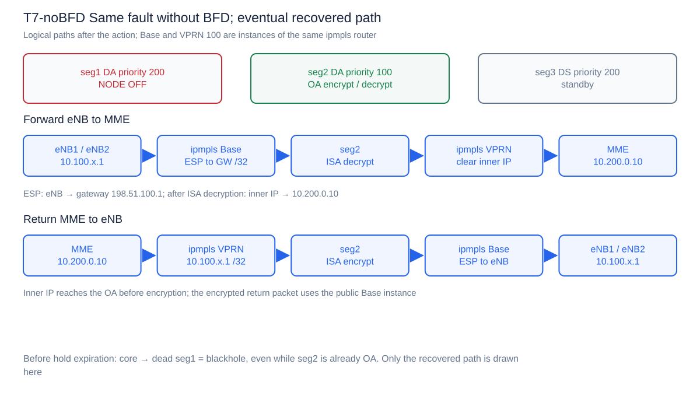

Повторить T7, предварительно удалив group override `bfd-liveness` на Base/VPRN группах core
всех SecGW и segw на ipmpls. Для этой версии CLI используется **delete override**;
явное `bfd-liveness false` в данном контексте было отвергнуто валидацией SR OS.
Отключается BFD BGP до core, а не вся BFD/MIMP связность между SecGW.

```text
delete /configure router "Base" bgp group "core" bfd-liveness
delete /configure service vprn "mobile" bgp group "core" bfd-liveness
# На ipmpls те же контексты с group "segw"
```

После отказа seg2 может быстро стать OA, но core продолжит отправлять трафик на dead seg1,
пока BGP не обнаружит отказ. Снять `show router bgp neighbor 172.31.1.1`, проверить Bfd Enabled,
Active Hold Time и старый маршрут 198.51.100.1/32. В конкретном запуске hold был 90 секунд;
оставшееся ожидание зависит от времени последнего KEEPALIVE, поэтому оно не обязано быть
ровно 90 секунд с момента отключения.

Схема показывает конечный путь через seg2. До истечения hold фактический public path может
быть eNB → core → dead seg1, то есть blackhole при уже правильном OA в MC-IPsec.
Измерение нельзя завершать через произвольные 20–30 секунд и называть этот хвост временем
восстановления. Ждать реального восстановления обоих потоков, максимум 180 секунд по runner,
затем возвращать seg1, проверять отсутствие дополнительных потерь и включать BFD обратно
`bfd-liveness true` на всех изменённых группах. Если срок истёк, публиковать незавершённый
outage/ошибку, а не PASS по одному факту выбора seg2.

### T8 Одновременный отказ обоих DA с обычным pool

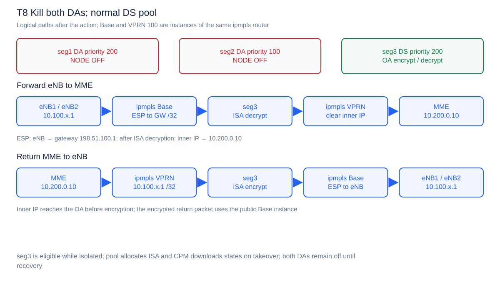

**Подготовка.** На seg3 `pool1 high-availability none`; рабочий OA seg1. Все узлы nominal,
маршруты core через seg1. Обе IKE должны быть установлены до начала окна. Подтвердить
реальный режим командой `show isa tunnel-member-pool pool1 detail`, а не только текстом
ожидаемой конфигурации.

**Действие.** Одновременно остановить CPM и все IOM компоненты seg1 и seg2. Seg3 остаётся
единственным работающим SecGW. Его isolated-state может быть `eligible`; он должен локально
стать OA, выделить ISA из pool, установить синхронизированные состояния и принять трафик.
Core должен выбрать seg3 для 198.51.100.1/32 и обоих private /32.

Запрос после сходимости: eNB → core Base → seg3 ISA decrypt → core VPRN → MME. Ответ:
MME → core VPRN → seg3 ISA encrypt → core Base → eNB. DA не запускать, пока оба потока
не восстановились. Подтвердить сохранение обеих IKE, установленные CHILD SA и два installed
tunnels на seg3; опубликовать потери и gap каждого eNB. Переход на DS считается stateful
только при сохранённых IKE. После оценки T8 оставить DA выключенными для отдельного T8r.

### T8r Возврат обоих DA после обычного DS takeover

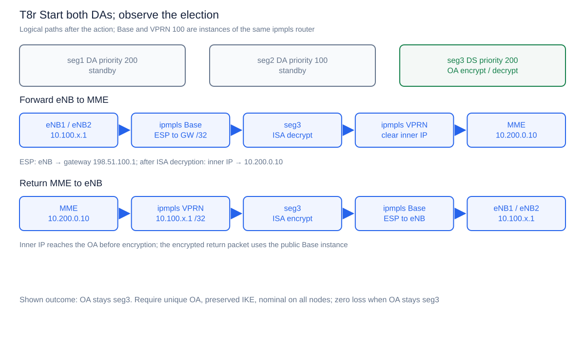

Начать отдельное стабильное окно через seg3 и запустить компоненты обоих DA. Дождаться CLI
seg1/seg2, согласованного единственного OA и nominal на всех узлах. Проверить обе исходные
IKE и восстановленный трафик. Изолированный DS при возвращении peers участвует в согласовании
домена; фактический исход выборов фиксируется в журнале. Схема показывает исход, при котором
OA остаётся seg3. Если выбрана другая единственная OA, требуется публиковать эту смену и
её измеренный трафик, а не оставлять в отчёте заранее заданный seg3.

Если OA остаётся seg3, принят строгий критерий нулевых потерь на каждом eNB: рабочая ISA
не меняется. Измерение длится от запуска DA до полного nominal, поэтому короткий ping сразу
после старта контейнеров его не заменяет. Снять события `mc_redundancy` всех трёх узлов.
Единичная потеря при сохранённом OA — FAIL по этому критерию; успешный повтор не удаляет
первоначальный результат. Возможное влияние сна/планировщика хоста требует отдельных evidence.

### T9 Одновременный отказ DA с HA pool


**Цель.** Повторить T8 с HA pool и сравнить функциональное восстановление. Nokia описывает
предварительную загрузку состояний всех связанных tunnel-groups на ISA pool. Scale mode
`tunnel-limit-32k` задаёт предел всего pool; это не количество тестовых туннелей и не
доказательство проверки масштаба 32k. В этом стенде по-прежнему только два туннеля.

```text
/configure isa tunnel-member-pool "pool1" high-availability tunnel-limit-32k
```

**Отдельная подготовка.** Режим должен быть готов до начала измерения T9. Изменение HA,
перезапуски для его подготовки, выделение памяти и повторное установление baseline не
являются частью failover-окна. Runner использует отдельную offline-подготовку:

1. При OA на seg1/seg2 остановить только CPM/IOM обоих DA. Core, eNB и все распределённые
   netns helpers оставить запущенными, чтобы сохранить data links.
2. До выделения таблиц требовать не менее 10 ГиБ **физической** MemAvailable; SwapFree
   в этот запас не входит. При отказе guard вернуть DA и прекратить серию.
3. Отключить ISA seg3, задать HA 32k и сохранить конфигурацию. Холодно запустить CPM и IOM
   seg3; для IOM задать cgroup 8 ГиБ RAM / 9 ГиБ RAM+swap.
4. Дождаться CLI, включить ISA, дождаться operational и сохранить включённое состояние.
   Наблюдать ISA ещё 60 секунд, затем запускать DA по очереди с проверкой CLI и маршрутов.
5. Восстановить полный baseline. IKE может пересоздаться в этом offline-обслуживании;
   контрольные SPI измеряемого T9 фиксируются **после** готовности baseline.

Это процедура для данного SR-SIM стенда, а не рекомендованное обслуживание аппаратного
SecGW. Этапы обслуживания и условия ресурсов приведены в [операционных примечаниях](operational-notes.md).

Проверить фактический `High Availability : tunnel-limit-32k`, operational ISA, eligible/standby
seg3, nominal всех узлов, корректные forwarding-маршруты, две IKE и стабильный baseline
через seg1. Кратковременный `MDA up` без исправного tunnel-group недостаточен. Ошибка
выделения таблиц, assert, reboot или readiness timeout означает неготовую подготовку;
двойной отказ на таком стенде не вносится и результат T9 не объявляется PASS.

**Действие и оценка.** В новом окне остановить оба DA, как в T8. Требовать восстановления
обоих потоков на seg3 до запуска DA и сохранения обеих IKE/CHILD. Путь пакетов совпадает
с T8; отличается подготовленное состояние ISA. Публиковать оба фактических gap. Один опыт
на два туннеля не подтверждает статистического преимущества HA и не переносится в SLA.

### T9r Возврат DA после HA takeover

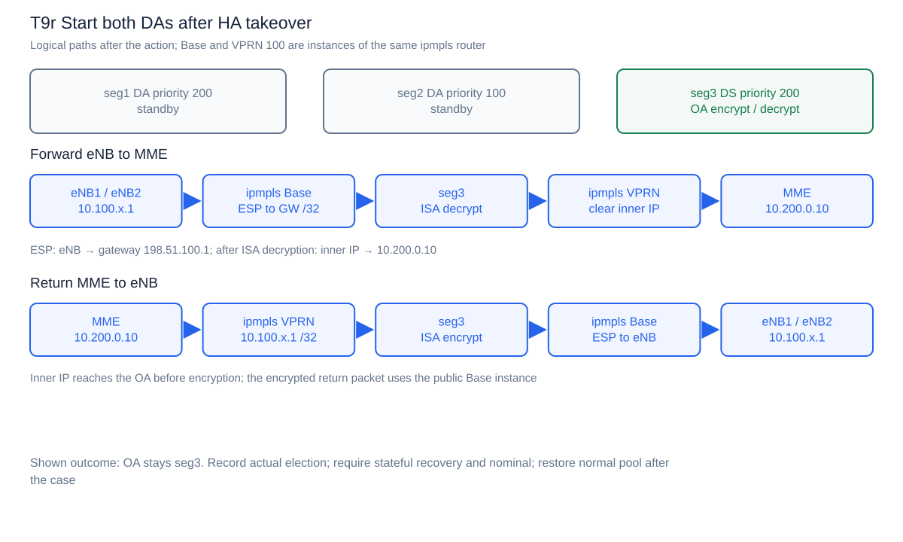

Выполнить отдельное окно возврата обоих DA по правилам T8r: CLI, согласованная единственная
OA, nominal, сохранённые IKE и восстановленный трафик. Если OA осталась seg3 — ноль потерь
на каждом eNB. Сохранить MC event logs, маршруты и SA до/после. Рисунок является примером
исхода, а фактическое значение OA берётся из измерения.

**Восстановление после HA группы.** Штатно вернуть OA на seg1, затем на standby seg3
восстановить pool `high-availability none` по подтверждённой процедуре. Проверить фактический
режим и полный nominal baseline. Изменение pool не включать в T9r. Если режим сохранялся
в startup config для холодного запуска, сохранить также его обратное изменение: следующий
перезапуск не должен неожиданно включить HA. Ошибка очистки фиксируется отдельно, даже если
сам measured failover прошёл.

### T10 Public shunting через каждый standby

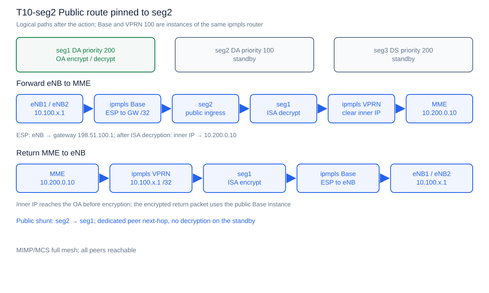

**Исходное состояние.** OA seg1 и nominal. Public gateway /32 принудительно принимается
core только от выбранного standby. Private /32 остаются на seg1. Вариант повторяется
через **seg2 и отдельно через seg3**: успешная работа через одного peer не доказывает
корректность профиля другого.

Закрепление выполняется BGP import policy на ipmpls: префикс 198.51.100.1/32 отклоняется
от двух других SecGW и принимается от целевого. Остальные маршруты пропускаются. Это
не статический маршрут: тест требует существующее объявление standby и его peer next-hop.
Пример параметров политики на core:

```text
prefix-list test-pin-public: 198.51.100.1/32 exact
policy-statement test-pin-public:
  entry 10: from test-pin-public; action reject
  default-action accept
Base neighbor 172.31.2.1: import accept-all
Base neighbors 172.31.1.1 and 172.31.3.1: import test-pin-public
```

Это описание параметров; точные MD-CLI команды и commit видны в логе runner.
В MD-CLI `import policy` является списком: повторная запись может дополнить прежнюю
цепочку. Перед назначением нового списка runner удаляет neighbor `import` и задаёт
нужную policy в той же candidate-транзакции. Иначе прежняя reject policy может остаться
первой и сорвать закрепление на следующем standby.
После применения **дождаться фактического маршрута**, а затем начинать стабильное окно.
Период административного закрепления относится к подготовке и не входит в измерение
уже установленного shunting path.

Запрос: eNB → core Base → seg2 public ingress → public shunt по LAG 12 → seg1 ISA decrypt
→ core VPRN → MME. Обратный пакет идёт обычным путём через seg1, потому что private route
не закреплялся на standby. Seg2 не должен устанавливать себя OA или расшифровывать ESP.
После 10 секунд проверки требуется ноль потерь, прежние IKE, OA seg1 и выбранный public
route через seg2. Вариант для seg3 использует LAG 13 и тот же принцип:


### T10b Отрицательный контроль public shunting

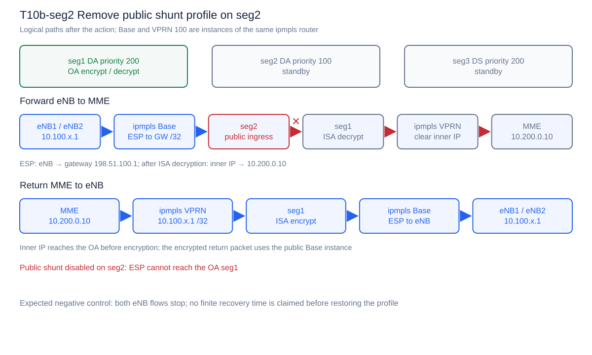

Не снимая закрепление gateway route, начать отдельное стабильное окно и удалить профиль
**на выбранном standby**, а не на OA:

```text
delete /configure service ies "public" interface "pub" multi-chassis-shunting-profile
```

Наблюдать ещё 10 секунд. ESP должен продолжить приходить на standby, но не пересылаться
к OA: ping обоих eNB перестаёт получать ответы. OA и обе IKE должны сохраниться. Наличие
потерь и незавершённого outage у обоих источников подтверждает, что положительный T10
работал благодаря shunting, а не благодаря случайно сохранившемуся маршруту через OA.

Восстановить на standby:

```text
/configure service ies "public" interface "pub" multi-chassis-shunting-profile "shunt-pub"
```

Дождаться CHILD SA и нормальной передачи. Затем повторить T10/T10b с public route на seg3:

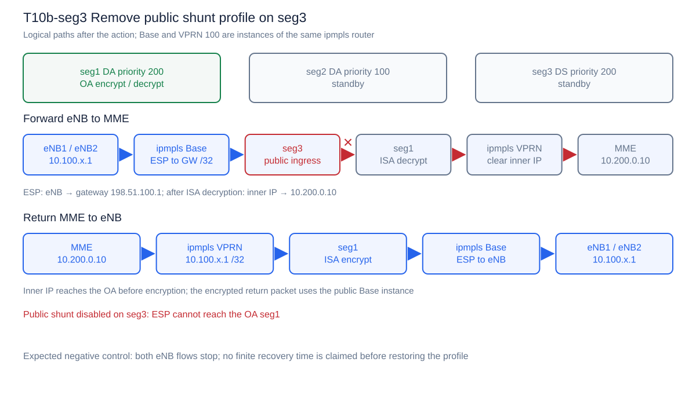

После обоих вариантов удалить neighbor import overrides и проверить возврат gateway /32
через seg1. Negative control не должен становиться «быстрым recovery»: перед восстановлением
профиля его outage специально не завершён, поэтому публикуется нижняя граница по окну.

### T11 Private shunting через каждый standby


OA seg1, nominal. Теперь в VPRN 100 на ipmpls закрепить оба private /32 за seg2, а gateway /32
оставить через seg1. Политика отклоняет `10.100.0.0/16 longer` от остальных SecGW,
другие маршруты принимает. Для seg2 целевой peer — 172.30.2.1; для seg3 — 172.30.3.1.
До начала измерения проверить **оба** маршрута 10.100.1.1/32 и 10.100.2.1/32.

Запрос идёт обычным путём через ISA seg1 к MME. Ответ: MME → core VPRN → standby seg2
private ingress → private shunt по VLAN 3 LAG 12 → seg1 ISA encrypt → core Base → eNB.
Шифрование остаётся на OA; standby пересылает внутренний пакет. Наблюдать 10 секунд,
требовать ноль потерь на обоих eNB, те же IKE и OA seg1. Повторить через seg3/LAG 13:

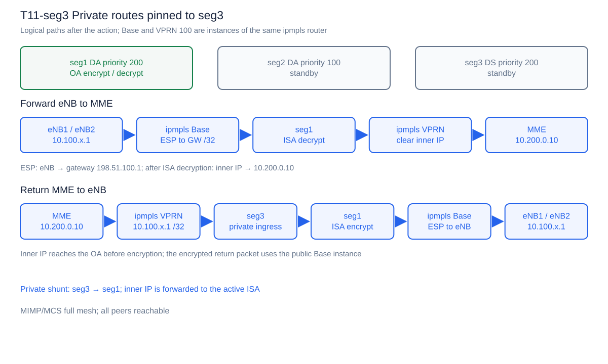

### T11b Отрицательный контроль private shunting


При сохранённых private route pins удалить private shunt profile на выбранном standby:

```text
delete /configure service vprn "mobile" interface "priv" multi-chassis-shunting-profile
```

Запросы к MME ещё могут доходить по рабочему forward path, но ответы попадают на standby
и не достигают активной ISA. Поэтому round-trip ping обоих eNB должен перестать получать
ответы. Это не означает обязательную блокировку всех запросов на MME. Наблюдать 10 секунд,
проверить сохранение OA/IKE и unrecovered tail на обоих eNB.

Восстановить `multi-chassis-shunting-profile "shunt-priv"`, дождаться рабочих CHILD SA
и повторить тот же контроль на seg3:

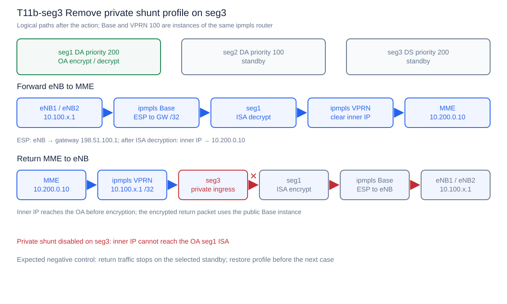

После вариантов снять private route pins. Public и оба private /32 должны снова идти через
seg1. Prefix-list и policy definitions могут остаться как неиспользуемые тестовые объекты;
на forwarding влияет именно отсутствие neighbor import overrides, что проверяется cleanup.

### T12 Переключение с отказавшим member A и shunting через member B


**Цель.** Проверить реальный public/private shunting по оставшемуся участнику LAG, а не
только сохранение control-plane связности после потери порта.

1. Начать стабильное измерение на nominal seg1.
2. Отключить seg1 port 1/1/1 — member A LAG 12. Member B оставить включённым.
3. Выполнить управляемое переключение OA на seg2. До команды проверить nominal и forwarding
   routes seg2. Дождаться устойчивого трафика через новую OA.
4. На core закрепить **gateway /32 и оба private /32 за former OA seg1**.
5. Дождаться подтверждения всех маршрутов, наблюдать ещё 10 секунд и проверить устойчивый трафик.

Запрос: eNB → core Base → seg1 public ingress → shunt member B → seg2 ISA decrypt → private
core → MME. Ответ: MME → core VPRN → seg1 private ingress → shunt member B → seg2 ISA encrypt
→ public core → eNB. Для compact member B — 1/1/2, для dual-IOM — 2/1/1.

Ожидается OA seg2, обе прежние IKE и восстановленные потоки. Потери самого переключения
входят в полное окно T12, поэтому требование нулевых потерь ко всему T12 не применяется.
Стабильная конечная часть с pins и выключенным A доказывает рабочий surviving shunt path.
Снять pins, включить A, проверить LAG с двумя up-members, затем восстановить nominal seg1 baseline.

## Финальное восстановление стенда

Cleanup возвращает выключенные узлы, ISA и member ports; снимает neighbor route pins,
восстанавливает public/private shunt profiles, BFD core и non-revertive. Если требуется
изменить revertive, оно меняется на standby. Перед финальной проверкой pool возвращается
в обычный режим `none` по описанной процедуре обслуживания.

Стенд считается восстановленным только при единственной OA seg1, nominal и согласованном
Current Active на всех трёх узлах, двух installed tunnels на OA, двух IKE/CHILD SA, gateway
и private /32 через seg1, forwarding routes всех SecGW, двух up-members каждого LAG,
ISA up, MCS inSync, выбранном общем NTP и обычном pool mode. Проверить также startup config,
если режим pool сохранялся для холодного запуска.

Итоговая конфигурация сохраняется на всех четырёх маршрутизаторах. Завершение программы
включает отдельную проверку operational state. При нарушении предусловий серия
останавливается, выполняется восстановление baseline, а новое измерение начинается
после повторной проверки готовности.

## Основания в документации Nokia

- [IP tunnels 26.7](https://documentation.nokia.com/sr/26-7/7750-sr/books/ms-isa-esa/ip-tunnels.html):
  N:M election, protection, pool HA, state synchronization, CHILD rekey, shunting и deployment requirements.
- [Revertive MD-CLI](https://documentation.nokia.com/sr/26-7/7750-sr/books/md-cli-command-reference/redundancy-redundancy_0.html#d43733):
  влияние изменения настройки на admin-state домена.
- [SR-SIM overview](https://documentation.nokia.com/sr/26-7/7x50-shared/srsim-installation-setup/sr-sim-overview.html):
  совместное использование ресурсов хоста и нестабильность при недостаточном ресурсе.
- [SR-SIM host requirements](https://documentation.nokia.com/sr/26-7/7x50-shared/srsim-installation-setup/host-machine-requirements.html):
  минимальная память для загрузки не равна потребности конкретной функции и состава line cards.

Документация проверялась через nokia-docs. Исторические resolved issues другой версии и
таблицы памяти VSR не следует автоматически применять к SR-SIM 26.7.R2. Наблюдения этого
стенда и гипотезы о причинах должны оставаться явно отделены от документированных требований.
