# Nokia SR OS N:M MC-IPsec test program

This program validates stateful switchover, recovery and shunting for a three-node SecGW
on SR-SIM 26.7.R2. Each scenario identifies the initial state, the component or setting changed,
the expected roles and routes, both packet directions, acceptance criteria and restoration.
Accepted measurements are in [RESULTS.md](../RESULTS.md).

The program uses two IPsec tunnels. Measured SR-SIM gaps describe this lab; hardware acceptance
loads, scale and numerical SLA thresholds are agreed separately.

## Lab and roles

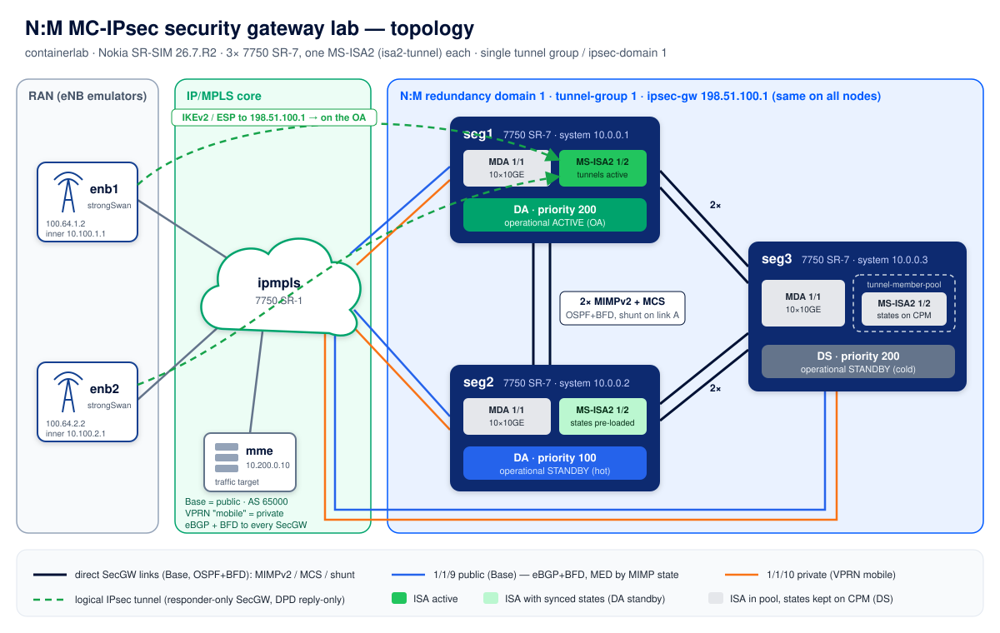

| Node | Purpose | Designated role | Priority | System address |
|---|---|---|---|---|
| seg1 | Preferred SecGW | DA | 200 | 10.0.0.1 |
| seg2 | Second SecGW, with synchronized states on its ISA | DA | 100 | 10.0.0.2 |
| seg3 | Reserve SecGW with an ISA tunnel-member-pool | DS | 200 | 10.0.0.3 |
| ipmpls | One core router for the public and private sides | — | — | See topology/configuration |
| enb1 / enb2 | IKEv2 initiators and user-traffic sources | — | — | See addresses below |
| mme | Inner-traffic destination and reply source | — | — | 10.200.0.10 |
| ntp | Shared lab time reference | — | — | Management 172.20.30.123 |

DA and DS are configured roles. OA is the current operational active. Having two DAs does not
mean that both simultaneously process this domain's traffic. Exactly one node is the OA.
The only surviving SecGW can report Activity State `eligible` and locally act as OA while
isolated. Checks therefore examine all participants rather than accepting the first active response.
After connectivity returns, all participants must agree on one Current Active and reach `nominal`.

`ipsec-domain 1` is associated with `tunnel-group 1`, with `active-isa-number 1`.
Each DA binds ISA 1/2 directly to the tunnel group. The DS uses `pool1`.
With a normal pool, synchronized states are held on the CPM and downloaded to the ISA on takeover.
With pool HA, states are preloaded on the ISA and must still be activated when the node takes over.

| Object | Value |
|---|---|
| Public eNB1 / eNB2 address | 100.64.1.2 / 100.64.2.2 |
| Inner eNB1 / eNB2 address | 10.100.1.1/32 / 10.100.2.1/32 |
| Shared IPsec gateway address | 198.51.100.1/32 on every SecGW |
| MME network and test destination | 10.200.0.0/24; 10.200.0.10 |
| Public routing instance | Base on SecGW and ipmpls |
| Private routing instance | VPRN 100, named mobile |
| Core AS / SecGW AS | 65000 / 64512 |
| MED: OA with peer / OA without peer / standby | 100 / 200 / 1000 |
| IKE lifetime: SecGW / eNB | 172800 / 86400 s |
| CHILD lifetime: SecGW / eNB | 7200 / 3600 s |
| DPD on SecGW | reply-only; eNB initiates checks |

### Reading the per-test topology views

The [topology gallery](TOPOLOGY-TESTS.md) contains a complete map for every measured window.
Each map retains both eNBs, MME, the single core, all three SecGWs, all three inter-SecGW LAGs
and the shared NTP reference.

- Blue arrows: requests from the eNBs to MME.
- Orange arrows: replies from MME to the eNBs.
- Green: the OA and its active ISA.
- Red crosses or red component labels: a disabled component or a blocked path.
- Dashed teal arrows in T6: the alternate MIMP/MCS path, separate from user traffic.
- Thin lines: physical lab connectivity, including links not selected for user traffic.

Base and VPRN 100 are instances of **one** ipmpls router. They are not separate core devices.
The banner states the action and the resulting role. Return tests mark restored components.
The T7-noBFD map includes the transient path toward the failed node before BGP hold expiry;
its main arrows show the recovered path. T8r/T9r illustrate the accepted outcome with seg3 as OA.
The original [packet-processing diagrams](scenarios/) remain available as companion views.

## Link redundancy

Each SecGW pair has a two-member LACP LAG. VLAN 1 carries control/public connectivity and
public shunting; VLAN 3 carries private shunting. MIMP/MCS uses system-address reachability
provided by OSPF. When LAG 12 is lost, the control path can traverse seg3 using LAGs 13 and 23.
Shunting to a particular peer uses its configured directly connected next-hop. Alternate control
reachability does not replace the direct shunting data path.

| LAG | Pair | Compact member ports |
|---|---|---|
| 12 | seg1–seg2 | 1/1/1 and 1/1/2 on both nodes |
| 13 | seg1–seg3 | seg1 1/1/3 and 1/1/4; seg3 1/1/1 and 1/1/2 |
| 23 | seg2–seg3 | 1/1/3 and 1/1/4 on both nodes |

Compact uses one IOM per SecGW, with both pair members on one network MDA. T5/T6/T12 validate
port/link failures in this profile. The [dual-IOM reference profile](../profiles/dual-iom.clab.yml)
moves member B from 1/1/2 to 2/1/1, and from 1/1/4 to 2/1/3, to model separate IOM placement.
Generate it with `python3 gen_configs.py --dual-iom` and set
`TOPOLOGY=profiles/dual-iom.clab.yml`. Regenerate without `--dual-iom` before returning to compact.
Deploy one profile at a time in the management network. Published measurements use compact.

## Normal user-traffic path

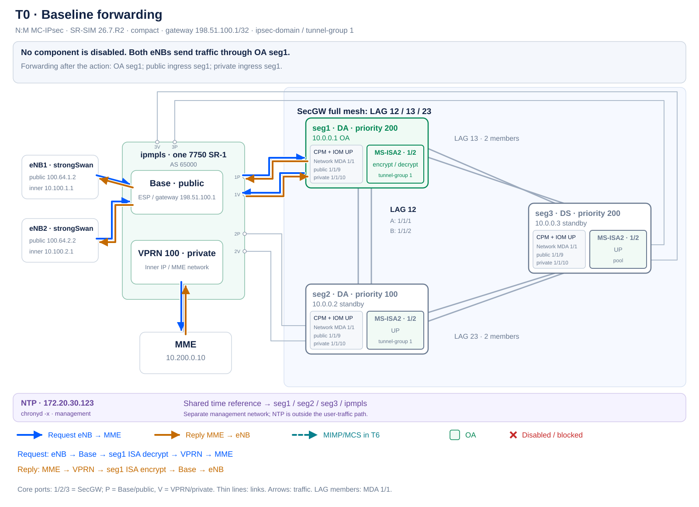

An eNB1 request has inner source 10.100.1.1 and destination 10.200.0.10. StrongSwan encrypts it.
The core Base instance selects the gateway /32 toward the OA. The active ISA decrypts ESP;
the inner packet then traverses the private VPRN to MME. eNB2 follows the same sequence.

The reply starts at MME. The core VPRN selects the eNB inner /32 toward the OA. Its ISA encrypts
the inner reply, and the outer packet traverses Base toward the eNB public address.
Decrypt/encrypt remains on the OA even when a standby is the selected ingress and shunts packets.

## Measurement method

Before each independent scenario, require:

1. Responsive CLIs, one OA, a consistent Current Active and nominal protection on all three SecGWs.
2. Two installed tunnels on the OA, plus established IKE and installed CHILD SAs on both eNBs.
3. The gateway /32 and both private /32 routes through the expected core next-hops.
4. BGP forwarding routes on **every** SecGW to 100.64.1.0/24, 100.64.2.0/24 and 10.200.0.0/24.
5. Successful readiness traffic before the measured window.

Outside measurement, readiness probes retry batches of 20 packets per eNB for at most 90 s,
until each eNB receives 20/20. SA listings before and after the probes are retained. This does
not reset IKE or peer domains. Nominal protection is checked separately. See
[operational conditions](operational-notes.md) for resource and pool-maintenance requirements.

Each eNB then runs:

```bash
ping -n -D -O -i 0.1 -W 1 -I 10.100.1.1 10.200.0.10
ping -n -D -O -i 0.1 -W 1 -I 10.100.2.1 10.200.0.10
```

The window starts with at least ten consecutive replies on each eNB and no missing initial
sequence numbers. START/STOP timestamps are recorded inside the source container.
The maximum gap includes the head before the first reply, intervals between replies and
the tail after the last reply. A no-loss 10-pps stream normally has reply intervals near 0.1 s.
The metric is an observed reply gap, including host scheduling, rather than exact forwarding downtime.

Recovery requires ten consecutive replies, with the last reply no more than 0.5 s old;
all ten must follow the current action. An outstanding `ping -O` notice is not final loss if
the matching reply later arrives. Completed packet loss comes from the transmitted/received
summary. Sequence numbers also support the separate node-return continuity checks.

Both SPI values of **each IKE SA** must be nonempty and unchanged across the window.
CHILD SAs must be installed. CHILD rekey during switchover is expected: Nokia describes
rekey to reset ESP sequence numbers. The program therefore preserves IKE identity while
allowing CHILD SPI changes.

| Check | Acceptance |
|---|---|
| Stateful failover | Expected unique OA; both IKE pairs preserved; both flows recover |
| No loss | Stateful conditions plus zero lost packets on both eNBs |
| Negative shunting control | OA/IKE preserved; both flows lose replies and remain blocked at window end |
| seg1 return in T7 | No additional missing sequence numbers after node startup begins |
| DA return in T8r/T9r | Unique OA, nominal and preserved IKE; zero loss when seg3 remains OA |
| Sequential failures in T13/T14 | Verify the intermediate seg2 checkpoint before the second fault; original IKE pairs preserved across both faults and DA return |

**Operational BFD:** the configuration requests 100-ms transmit/receive with multiplier 3.
In this SR-SIM instance, MC-IPsec uses `cpm-np` sessions operationally at 1000 ms × 3;
core BGP uses `iom` sessions at 100 ms × 3. Nokia describes a 1000-ms negotiation floor
for simulated CPM-NP sessions in its [BFD simulation note](https://documentation.nokia.com/acg/24-7-2/books/mpls-classic/c079-mpls-tp.html).
The recorded session output is the basis for interpreting gaps. The simulator's interval
is not a recommended production timer. A smaller BFD detection timer alone does not
guarantee a proportional reduction in complete traffic-restoration time.

Failover tests apply functional criteria and publish the measured gaps separately.
A numerical hardware gap limit is not defined by this simulator program. Negative controls
intentionally end with an unrecovered tail: their gap bounds the observation window, not recovery time.
Failed preconditions produce INVALID; command errors/timeouts stop the series with diagnostics
and a nonzero exit status. Cleanup restores the baseline before another measurement.

## Execution and evidence

```bash
python3 -m unittest discover -s tests -v
./tests/nm_tests.sh all
# Independent groups; T1 includes T1b, T2 includes T3, T8/T9 include DA-return windows
./tests/nm_tests.sh T0 T1 T2 T4 T5 T6
./tests/nm_tests.sh T7 T7-noBFD T8 T9 T10 T11 T12
./tests/nm_tests.sh T13 T14
```

The full program has 29 windows: T0, T1, T1b, T2, T3, T4, T5, T6, T7, T7-noBFD,
T8, T8r, T9, T9r, four public-shunting windows, four private-shunting windows, T12,
and three phases each for T13 and T14 (first fault, second fault and DA return).
Each invocation writes `results/YYYYMMDD-HHMMSS/` with metadata, runner SHA-256, step logs,
original ping traces, JSON metrics and SUMMARY. Accepted evidence is published in
`results/validated-*`; [RESULTS.md](../RESULTS.md) identifies the source group for each window.

The default lab name below is `nm-mc-ipsec`; the runner reads the actual name from topology.
The measured WSL instance uses `tmo-secgw-nm`. `/configure ...` snippets are MD-CLI private
candidate changes followed by commit. For manual execution, a saved snippet can be applied
using `./apply_cfg.sh snippet.cfg seg1`. Use one runner at a time and avoid concurrent manual changes.

Useful observations:

```bash
./sros.sh seg1 'show redundancy multi-chassis ipsec-domain 1'
./sros.sh seg1 'show redundancy multi-chassis sync'
./sros.sh seg1 'show isa tunnel-group'
./sros.sh seg1 'show ipsec gateway name "enb-gw" tunnel'
./sros.sh seg1 'show lag'
./sros.sh seg1 'show mda'
./sros.sh seg1 'show system ntp all'
./sros.sh ipmpls 'show router route-table 198.51.100.1/32'
./sros.sh ipmpls 'show router "100" route-table 10.100.1.1/32'
./sros.sh ipmpls 'show router "100" route-table 10.100.2.1/32'
docker exec clab-nm-mc-ipsec-enb1 swanctl --list-sas
docker exec clab-nm-mc-ipsec-enb2 swanctl --list-sas
```

## Test scenarios

### T0 — Baseline forwarding

**Initial state:** seg1 OA, seg2/seg3 standby, all nominal. The T0 map above shows both directions.

**Action:** disable nothing. After a stable start, observe another 10 s.

**Traffic:** requests and replies use ISA seg1 through the normal Base/private path.

**Acceptance:** zero loss on both eNBs, both original IKE pairs, installed CHILD SAs and one OA seg1.
Subsequent failure scenarios require this baseline. T0 needs no configuration restoration.

### T1 — Planned switchover to the second DA

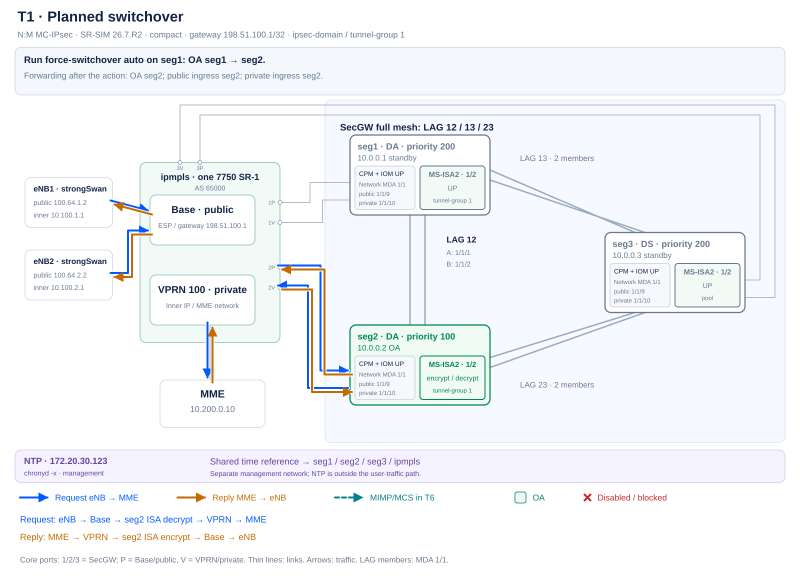

**Initial state:** seg1 OA and a nominal domain. seg2 has lower priority but is another DA;
seg3 is a DS. Check the forwarding routes on target seg2 before issuing the action.

**Action on the current OA:**

```text
tools perform redundancy multi-chassis mc-ipsec force-switchover domain 1 auto now
```

**Traffic:** seg2 is selected ahead of the DS. Core converges the gateway /32 and both private
/32 routes toward seg2. Requests traverse Base → seg2 ISA decrypt → VPRN → MME;
replies traverse VPRN → seg2 ISA encrypt → Base → eNB.

**Acceptance:** unique OA seg2, preserved IKE and recovered traffic on both eNBs. Switchover
loss is part of the measured window. CHILD rekey is allowed. Wait for nominal before T1b.

### T1b — Planned return to seg1

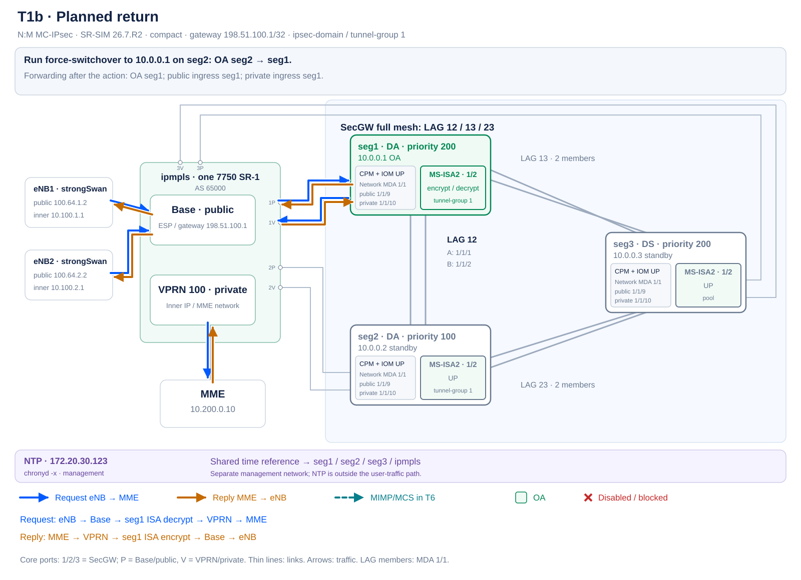

**Initial state:** stable traffic through seg2, with nominal protection and target seg1 routes ready.

**Action on seg2:**

```text
tools perform redundancy multi-chassis mc-ipsec force-switchover domain 1 to 10.0.0.1 now
```

**Acceptance:** the same stateful conditions, with OA seg1 and all three core /32 routes
returned to seg1. Reaching the first successful ping alone does not replace nominal readiness.
Prepare a complete nominal baseline before the next independent group.

### T2 — Active ISA failure

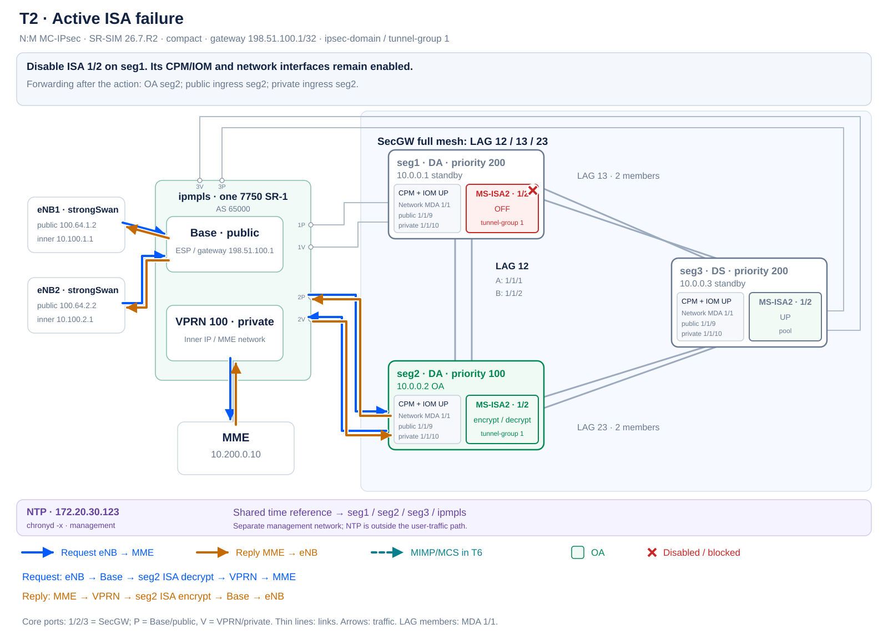

**Initial state:** seg1 OA, both IKE sessions established, nominal protection. seg1 CPM and
network ports are operational. This test isolates an ISA failure from a complete node failure.

**Action:** disable seg1 ISA MDA and commit:

```text
/configure card 1 mda 2 admin-state disable
```

**Traffic:** seg1 loses eligibility as OA; seg2 takes over. Public ESP and the private return
route converge toward seg2, and both directions use its ISA with the existing IKE sessions.

**Acceptance:** observe traffic recovery on both eNBs **before** enabling seg1 ISA.
Record activity/protection, installed tunnel counts, core routes, per-eNB loss and gap.
Leave the ISA disabled for the separate T3 recovery window.

### T3 — ISA return without reversion

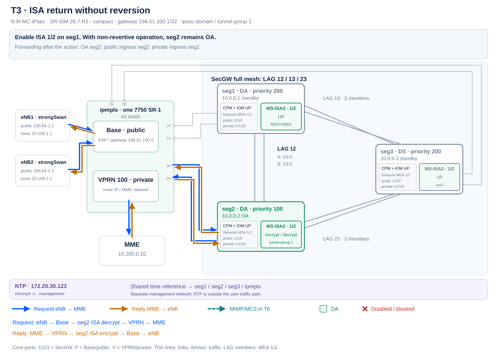

**Initial state:** continuation of T2, with seg2 OA, stable traffic through seg2 and seg1 ISA
disabled. The domain need not yet be nominal because the missing component is being restored.
`revertive false` is configured.

**Action:** begin a new stable window, then enable the ISA:

```text
/configure card 1 mda 2 admin-state enable
```

Wait for nominal on all participants, then observe another 10 s.

**Traffic and acceptance:** seg1 returns as standby and seg2 remains OA; neither packet
direction changes its working ISA. Require zero loss, both original IKE pairs and nominal.
seg1's higher priority alone must not force reversion. Before another independent group,
the runner performs any required baseline switchover outside that group's measured window.

### T4 — Automatic revertive return


**Preparation:** seg2 OA, all nominal. Disable the ISA and enable revertive on standby seg1
in one preparation transaction. Changing revertive is outside measurement because the Nokia
command reference states that this change toggles the domain administration state.

```text
/configure card 1 mda 2 admin-state disable
/configure redundancy multi-chassis ipsec-domain 1 revertive true
```

**Action:** start stable probes through seg2, then enable seg1 ISA. Do not issue a manual
force-switchover during the wait. seg1 must become standby, reach nominal and satisfy the
documented continuous standby/nominal eligibility interval of at least 60 s.
This is not an exact 60-s promise measured from ISA enablement. Record standby, nominal
and automatic active transitions separately from the user-traffic gap.

**Acceptance:** automatic OA seg1, core /32 convergence toward seg1, preserved IKE and
recovered flows. A manual takeover does not satisfy the automatic-reversion criterion.

**Restore:** wait for nominal, move OA to seg2, set `revertive false` on standby seg1,
then prepare the normal baseline. This keeps the revertive administration toggle off the OA.

### T5 — One LAG member fails

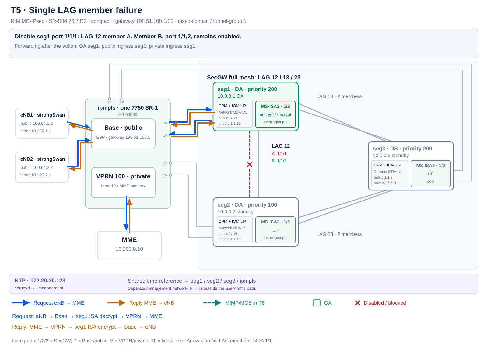

**Initial state:** seg1 OA, nominal, both LAG 12 members operational.

**Action:**

```text
/configure port 1/1/1 admin-state disable
```

Observe another 15 s after commit. Only member A on seg1 is disabled. Member B preserves
the inter-node connection.

**Traffic:** both directions retain the normal path through seg1 ISA. The OA does not change.

**Acceptance:** zero loss, preserved IKE, unchanged OA and healthy domain/MCS state.
Observe `show lag 12 detail` and, if needed, `show port 1/1/2`: LAG 12 has one active member.

**Restore:** enable port 1/1/1 and verify two active members. T12 separately exercises actual
shunted user traffic on surviving member B.

### T6 — Both direct links between seg1 and seg2 fail

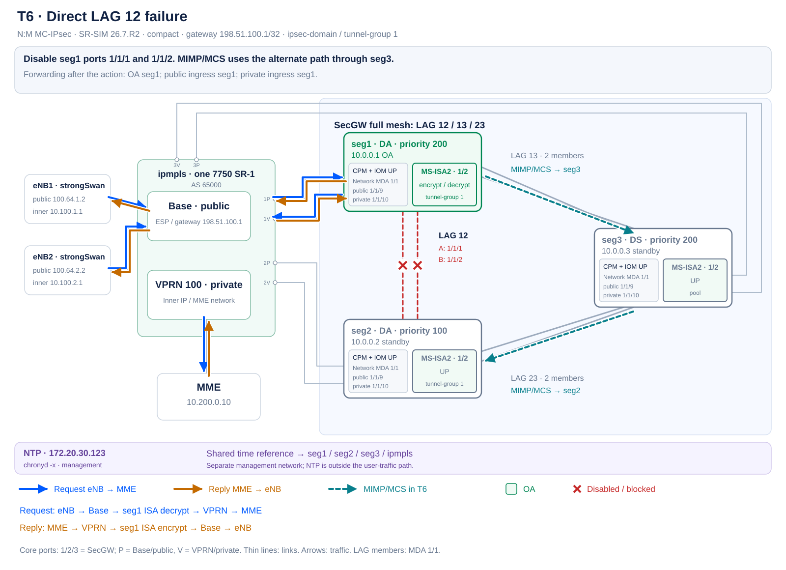

**Action in the nominal seg1 baseline:**

```text
/configure port 1/1/1 admin-state disable
/configure port 1/1/2 admin-state disable
```

In dual-IOM, the second port is 2/1/1. Observe for 20 s. Direct LAG 12 becomes unavailable.
OSPF retains system-address reachability over seg1 → LAG 13 → seg3 → LAG 23 → seg2.
In compact, seg1's route to 10.0.0.2/32 is expected to use next-hop 10.13.1.1.

**Traffic:** user packets still traverse ISA seg1 directly from/to the core. Only the
alternate control path is highlighted through seg3; user packets need not traverse seg3.

**Acceptance:** MIMP/MCS agreement, OA seg1 and protection nominal, with zero loss and
preserved IKE on both eNBs. Successful ping alone does not replace the nominal criterion.

**Restore:** enable both ports and verify two active members plus the normal direct route.

### T7 — Complete OA failure with core BFD

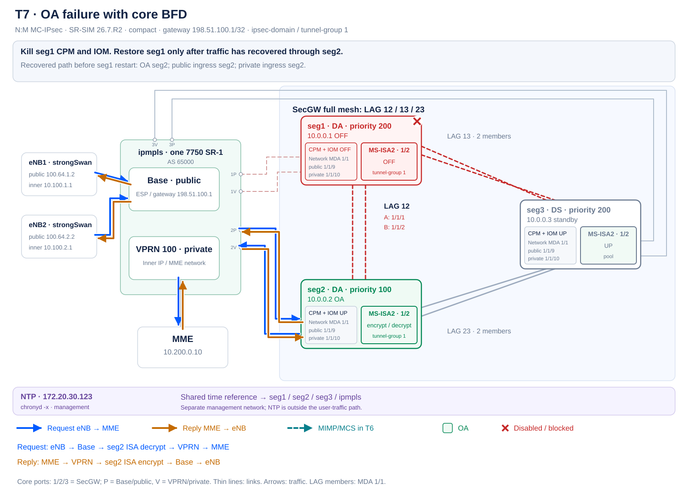

**Initial state:** seg1 OA, nominal. BFD is enabled on the Base and VPRN core/segw BGP groups
at both ends. Inter-SecGW MIMP/MCS BFD retains its own settings.

**Action:** kill seg1 CPM and every IOM component. In compact:

```bash
docker kill clab-nm-mc-ipsec-seg1-1 clab-nm-mc-ipsec-seg1-a
```

Add `clab-nm-mc-ipsec-seg1-2` for dual-IOM. This disables the complete simulated SecGW.
Keep its netns helper, the core, eNBs and other SecGWs running. seg2 must become unique OA;
the core removes the failed next-hop and selects seg2 in Base and VPRN.

**Measurement sequence:** retain one continuous ping trace across failure and node return.
First obtain ten consecutive new replies from both eNBs while seg1 remains off. Record
domain state, core routes and IKE pairs. Only then record `NODE RETURN WINDOW START`
and start seg1's components. Wait for its CLI, nominal on all nodes and stable traffic.
Check for additional missing sequence numbers from the last reply before startup through
the final reply after nominal.

**Acceptance:** OA seg2, unchanged IKE, traffic recovered before seg1 startup and no additional
loss caused by node return. The published T7 row covers the full window; its log identifies
the return boundary. Restore a nominal seg1 baseline before the next independent scenario.

**Observed timing:** the accepted T7 reply gaps are 2.947 / 2.953 s. Approximately 96 s
elapse from seg1 startup to all domains being observed nominal, with no additional packet
loss during node return. These are separate measurements: traffic already uses seg2
while seg1 boots and rejoins. See the [event timeline and interpretation](../RESULTS.md#traffic-restoration-versus-node-reintegration).

### T7-noBFD — Core-routing detection control

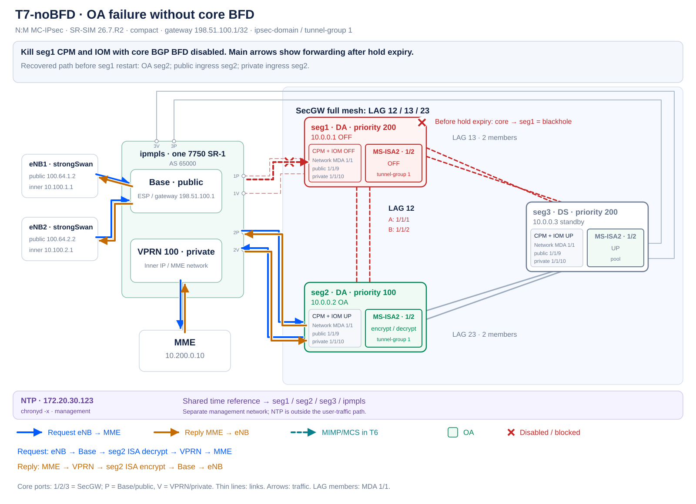

Repeat T7 after deleting the group `bfd-liveness` overrides on both Base/VPRN core groups
of every SecGW and both segw groups on ipmpls. This disables core BGP BFD; inter-SecGW
BFD/MIMP configuration remains in place.

```text
delete /configure router "Base" bgp group "core" bfd-liveness
delete /configure service vprn "mobile" bgp group "core" bfd-liveness
# On ipmpls, use group "segw" in the corresponding contexts.
```

seg2 can become OA before the core detects the failed seg1. Until BGP detection, the public
path can remain eNB → core → failed seg1: a blackhole despite the correct MC-IPsec OA.
Observe `show router bgp neighbor 172.31.1.1`, BFD status, Active Hold Time and the old
gateway /32 next-hop. The measured hold time is 90 s; remaining detection time depends
on the last KEEPALIVE, so the observed outage need not equal exactly 90 s after the kill.

The map distinguishes that transient red path from recovered forwarding through seg2.
Wait for actual recovery on both eNBs, with the runner's 180-s limit, before restarting seg1.
Apply the same stateful and node-return continuity checks as T7.

**Observed timing:** the accepted no-BFD reply gaps are 84.238 / 84.187 s. The captured
core state confirms the failed next-hop is retained with a negotiated 90 s BGP hold time.
This control demonstrates why OA takeover alone does not restore traffic when core routing
still selects the failed node. It does not describe the normal BFD-enabled configuration.

**Restore:** set `bfd-liveness true` on every modified group and return to the nominal baseline.

### T8 — Both DAs fail with a normal DS pool

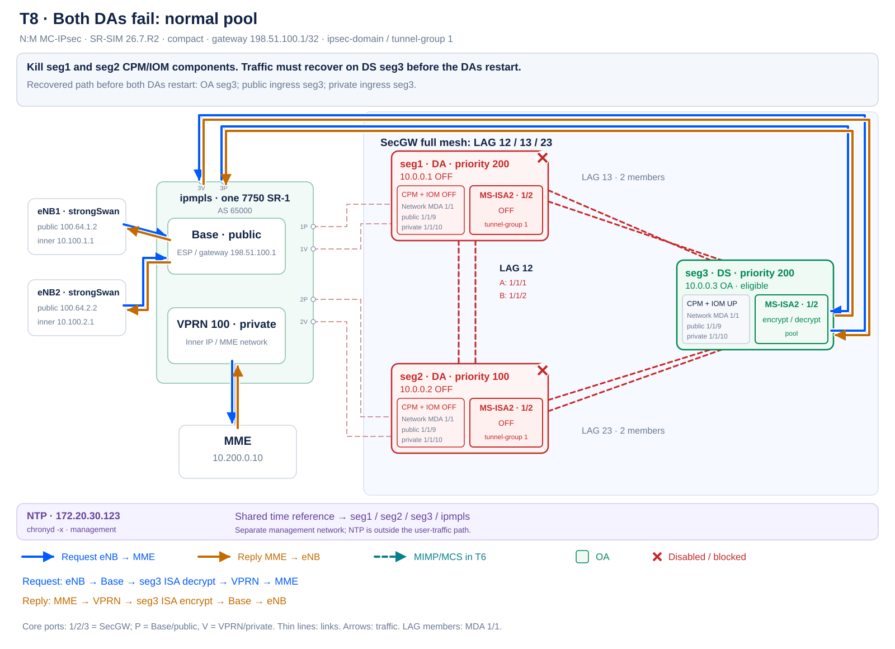

**Preparation:** seg1 OA, nominal, core routes through seg1, both IKE sessions established.
Set seg3 `pool1 high-availability none`. Verify the actual mode with
`show isa tunnel-member-pool pool1 detail`.

**Action:** simultaneously kill CPM and all IOM components of seg1 and seg2. seg3 is the
only surviving SecGW. It can report `eligible` while isolated, allocate an ISA from the pool,
install synchronized states and locally handle the domain.

**Traffic:** both requests and replies converge through seg3 ISA. Keep both DAs off until
recovery has been demonstrated on both eNBs.

**Acceptance:** seg3 as unique local owner, both original IKE pairs, installed CHILD SAs and
stable traffic. Record loss/gap independently on each eNB. Leave the DAs off for T8r.

### T8r — Both DAs return after normal-pool takeover

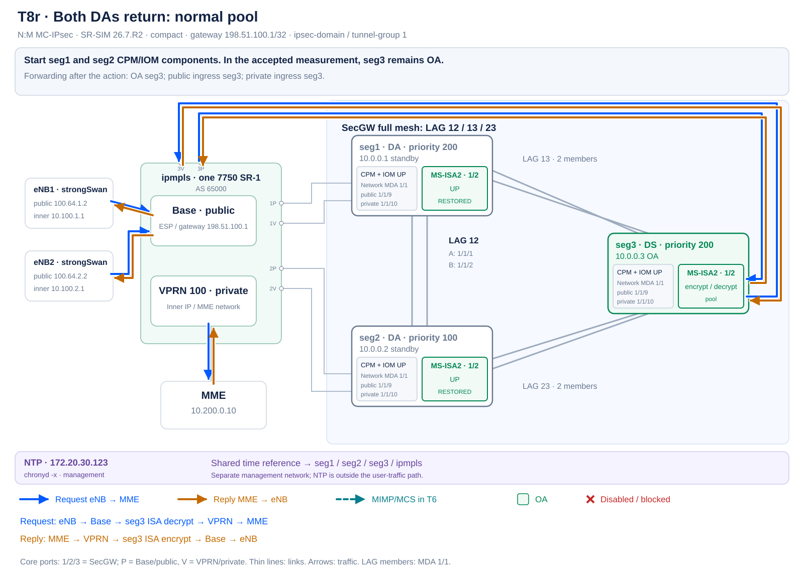

Begin a separate stable traffic window through seg3, then start both DAs' components.
Wait for both CLIs, one agreed OA and nominal on all nodes. Verify original IKE pairs and
traffic recovery. Record the actual election outcome rather than assuming a fixed result.

The map shows the accepted outcome with OA seg3. If seg3 remains OA, require **zero loss**
on each eNB because the working ISA does not change. If ownership changes, publish the
actual unique OA and measured stateful transition. The window covers startup through
full nominal, not just a short ping immediately after container startup.
Retain the `mc_redundancy` events from all three nodes.

### T9 — Both DAs fail with an HA pool

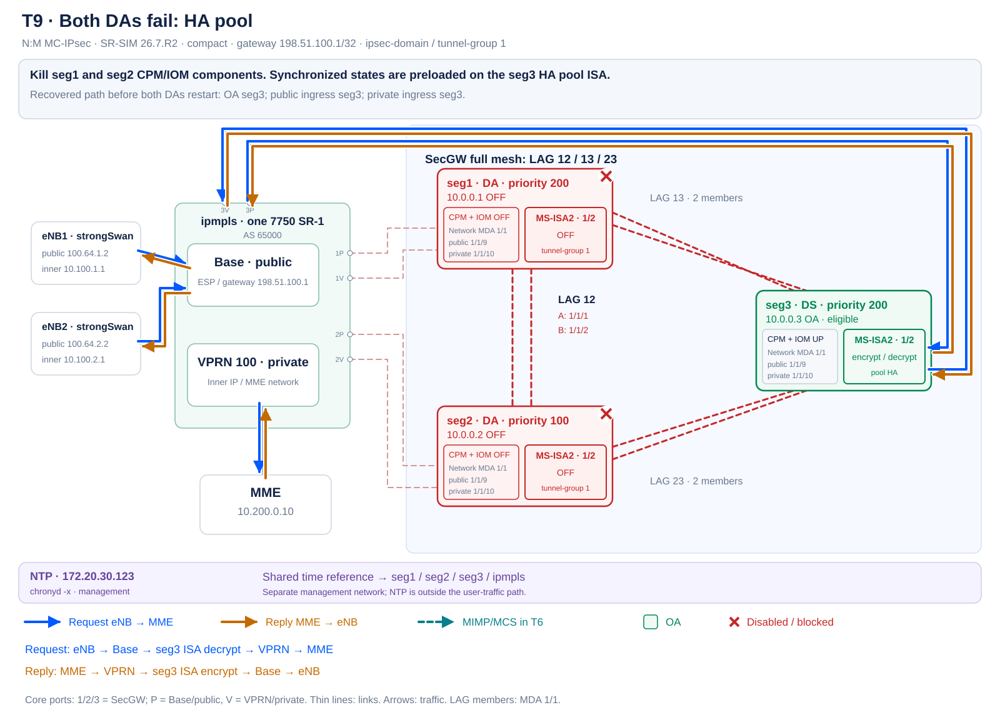

**Purpose:** repeat T8 with pool HA. Nokia describes preloading synchronized tunnel-group
states onto pool ISAs. `tunnel-limit-32k` defines the pool limit; this program still exercises
two tunnels and does not validate 32k tunnel scale.

```text
/configure isa tunnel-member-pool "pool1" high-availability tunnel-limit-32k
```

**Separate preparation:** HA changes, allocation, preparation restarts and baseline recovery
are outside the failover window. The runner uses this offline procedure:

1. Start with OA on seg1/seg2, then stop only the DA CPM/IOM components. Keep core, eNBs
   and all distributed netns helpers running to preserve data links.
2. Require at least 10 GiB **physical MemAvailable** before table allocation. SwapFree does
   not count. If the resource check fails, restore DAs and stop the series.
3. Disable seg3 ISA, set HA 32k and save. Cold-start its CPM and IOM with an IOM cgroup
   ceiling of 8 GiB RAM / 9 GiB RAM+swap.
4. Wait for CLI, enable ISA, wait for operational state and save the enabled configuration.
   Observe ISA for 60 s, then start DAs sequentially with CLI/forwarding-route checks.
5. Re-establish the full baseline. IKE can be renegotiated during this offline maintenance;
   capture T9's reference SPI pairs **after** baseline readiness.

This is the procedure for this SR-SIM lab; platform-specific hardware maintenance is separate.
See [operational notes](operational-notes.md). Require actual HA mode, an operational ISA,
nominal agreement, complete forwarding routes, both IKE sessions and stable traffic via seg1
before injecting the double failure.

**Action and acceptance:** in a new measured window, kill both DAs as in T8. Require
recovered traffic on seg3 before restarting the DAs and preserve both IKE pairs/installed CHILD SAs.
The packet path matches T8; the prepared ISA state differs. Publish both measured gaps.
One observation per mode on two tunnels does not establish a statistical HA speed advantage.

### T9r — Both DAs return after HA takeover

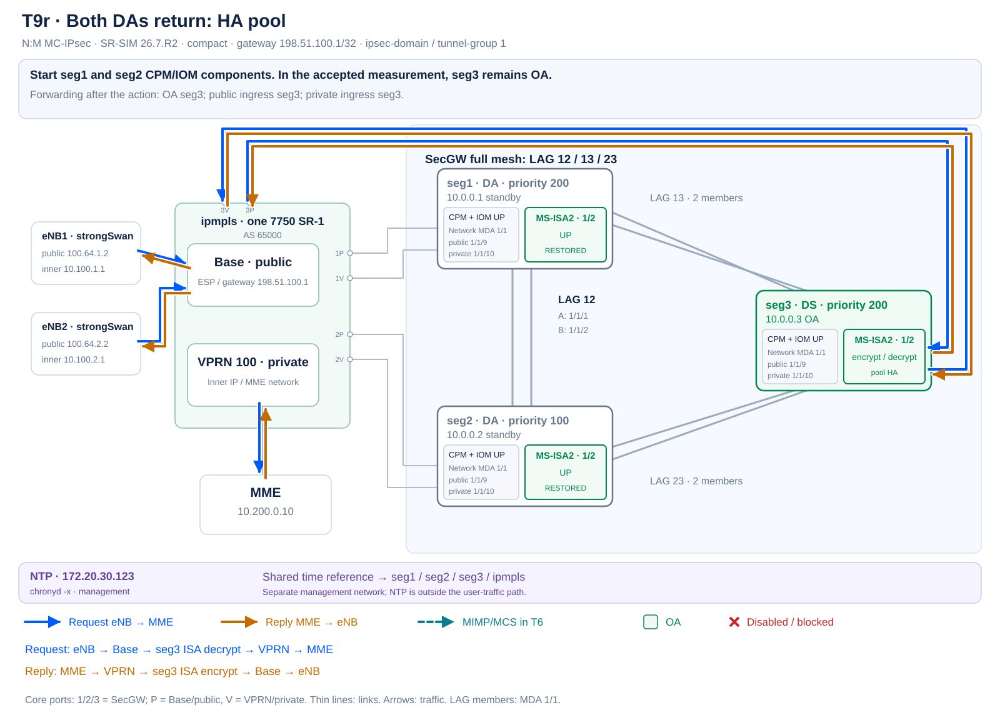

Use the same separate return window as T8r: CLI readiness, one agreed OA, nominal, preserved
IKE and recovered traffic. Require zero loss on both eNBs when seg3 remains OA.
Record MC events, routes and SA states before/after. The map shows the accepted seg3 outcome.

**Restore after the HA group:** return OA to seg1, then restore standby seg3 to
`high-availability none` using the pool-maintenance procedure. Verify actual mode and a
complete nominal baseline. Keep this maintenance outside T9r. Save the restored mode and
enabled ISA so a subsequent boot loads the intended normal configuration.

### T10 — Public shunting through each standby

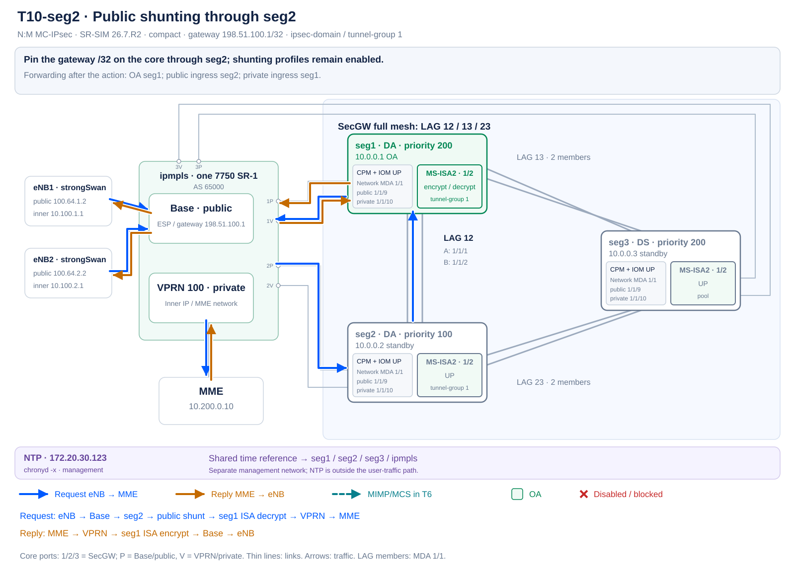

**Initial state:** seg1 OA, nominal. The core accepts the public gateway /32 only through the
selected standby; private /32 routes remain through seg1. Exercise **seg2 and seg3 separately**.

Pin routes with core BGP import policy: reject 198.51.100.1/32 from the other two SecGWs,
accept it from the selected standby and leave other prefixes accepted. This requires the
standby's existing BGP advertisement and peer next-hop, rather than a static route.

Example policy parameters for the seg2 variant:

```text
prefix-list test-pin-public: 198.51.100.1/32 exact
policy-statement test-pin-public:
  entry 10: from test-pin-public; action reject
  default-action accept
Base neighbor 172.31.2.1: import accept-all
Base neighbors 172.31.1.1 and 172.31.3.1: import test-pin-public
```

These are policy parameters; the runner log contains exact MD-CLI changes and commits.
MD-CLI merges the import-policy leaf-list. Replace a neighbor's import chain in one
candidate transaction: delete the old neighbor `import`, then set the required list.
Wait for the actual selected route before starting measurement. Administrative route-pinning
convergence is preparation, separate from the stable shunting-path check.

**Request:** eNB → core Base → seg2 public ingress → public shunt over LAG 12 →
seg1 ISA decrypt → core VPRN → MME.

**Reply:** MME → core VPRN → seg1 ISA encrypt → core Base → eNB.
The private route was not pinned, so the reply does not need the standby. seg2 remains
standby and forwards ESP to the OA rather than decrypting it.

**Acceptance:** observe for 10 s; require zero loss on both eNBs, preserved IKE, OA seg1
and the public route through seg2. Repeat through seg3 using LAG 13:

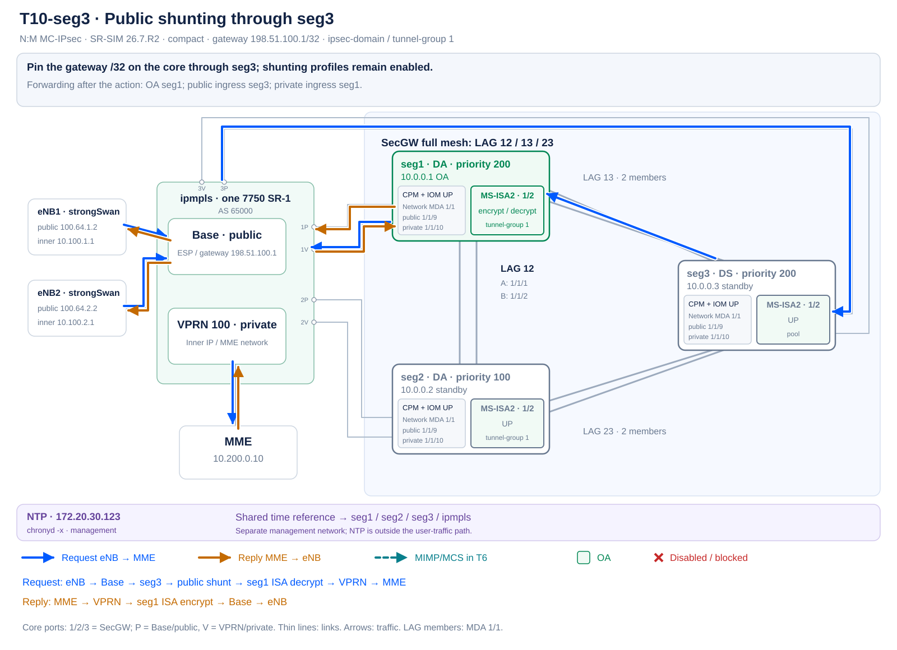

### T10b — Public-shunting negative controls

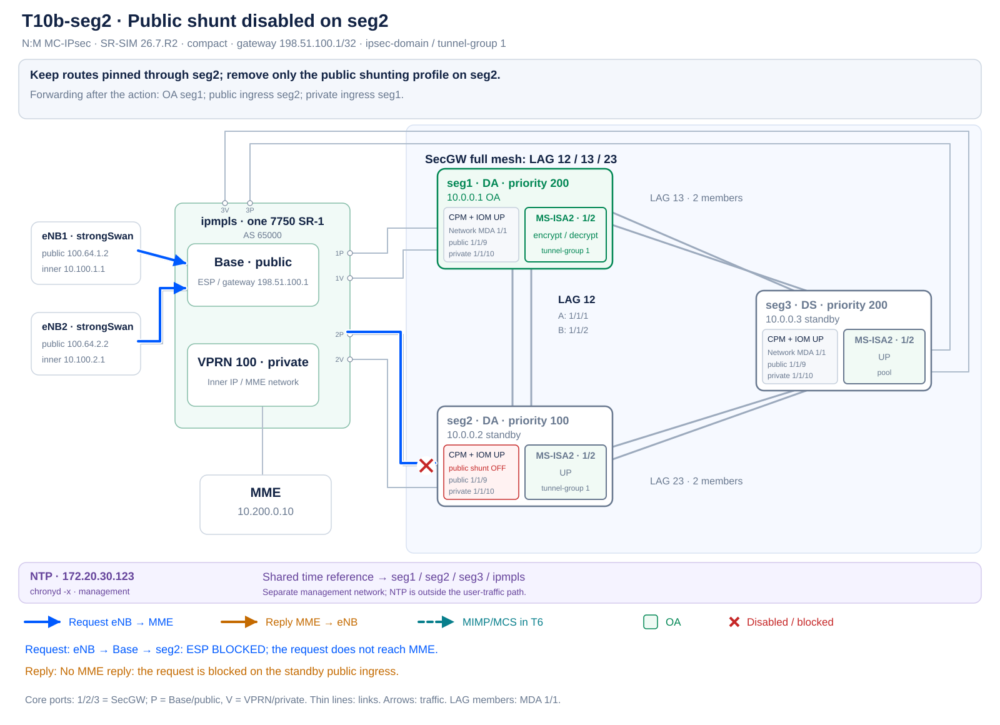

Keep the gateway route pinned. Start a separate stable window and remove the profile
on the **selected standby**, leaving the OA profile unchanged:

```text
delete /configure service ies "public" interface "pub" multi-chassis-shunting-profile
```

Observe for another 10 s. ESP still arrives at the standby but is no longer shunted to OA.
Requests do not reach MME, so both eNBs stop receiving replies. OA and both IKE pairs remain
unchanged. Require loss and an unrecovered tail on both sources. This demonstrates the
dependency on shunting in the positive test.

**Restore on the standby:**

```text
/configure service ies "public" interface "pub" multi-chassis-shunting-profile "shunt-pub"
```

Wait for installed CHILD SAs and stable traffic. Repeat T10/T10b with the public route through seg3:

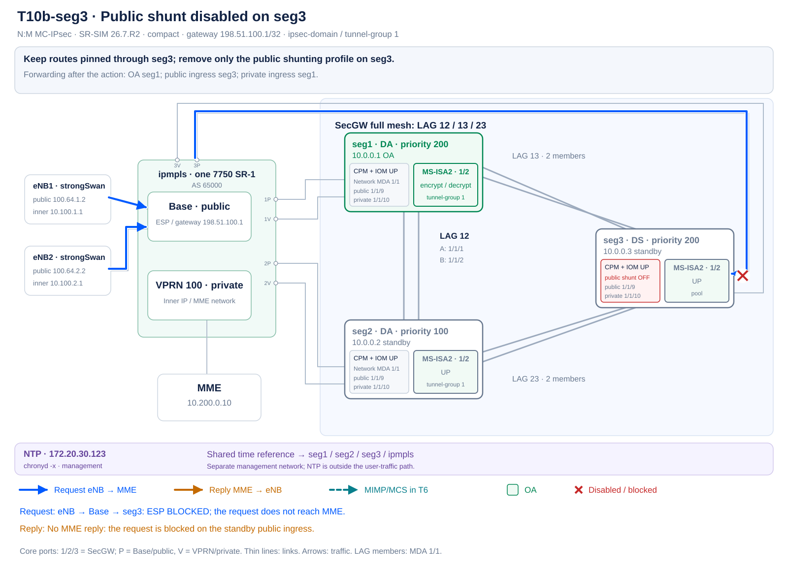

After both variants, delete neighbor import overrides and verify the gateway /32 through seg1.
The intentional unrecovered negative-control gap is the observation-window bound, not recovery time.

### T11 — Private shunting through each standby

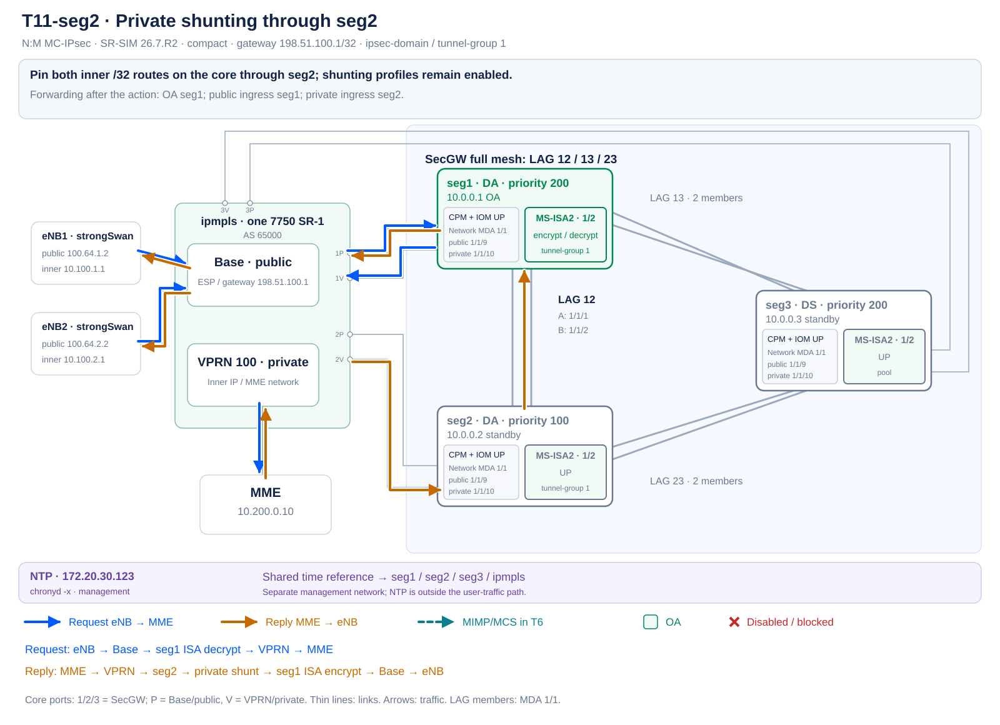

**Initial state:** seg1 OA, nominal. In core VPRN 100, pin both private /32 routes through
seg2 while leaving the gateway /32 through seg1. The policy rejects `10.100.0.0/16 longer`
from other SecGWs and accepts other prefixes. The selected peer is 172.30.2.1 for seg2
or 172.30.3.1 for seg3. Check **both** 10.100.1.1/32 and 10.100.2.1/32 before measurement.

**Request:** the normal path through seg1 ISA to MME.

**Reply:** MME → core VPRN → seg2 private ingress → private shunt over VLAN 3/LAG 12 →
seg1 ISA encrypt → core Base → eNB. Encryption stays on OA; standby forwards inner IP.

**Acceptance:** observe 10 s; require zero loss on both eNBs, unchanged IKE, OA seg1 and
both private routes through the selected standby. Repeat through seg3 using LAG 13:

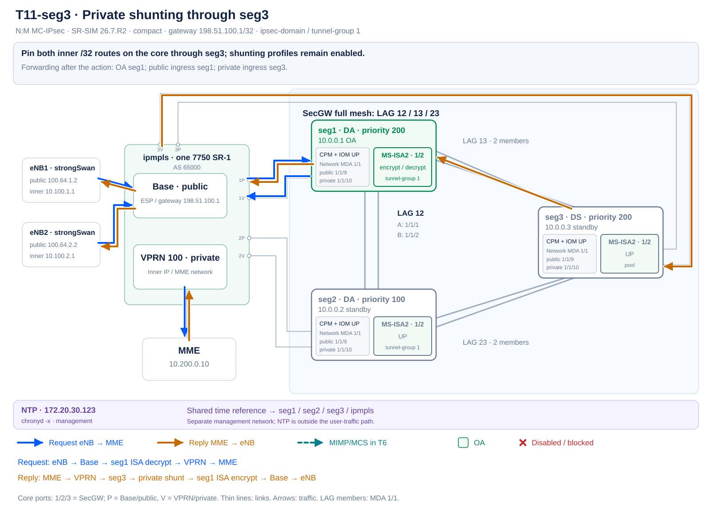

### T11b — Private-shunting negative controls

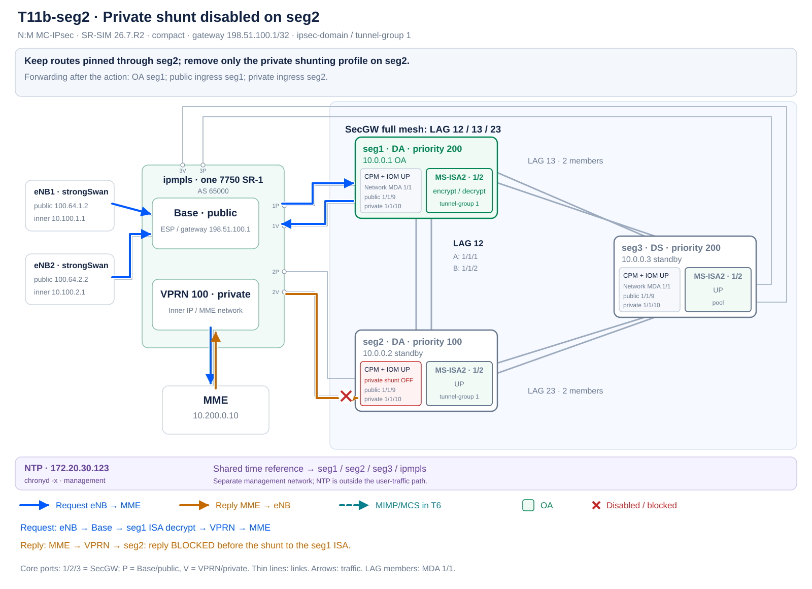

With private routes still pinned, remove the selected standby's private shunting profile:

```text
delete /configure service vprn "mobile" interface "priv" multi-chassis-shunting-profile
```

Requests can still reach MME over the working forward path. Replies now enter the standby
but cannot reach the active ISA, so round-trip ping stops on both eNBs. The diagram shows
the working request and the blocked reply separately.

**Acceptance:** observe another 10 s; require unchanged OA/IKE, loss and an unrecovered
tail on both eNBs. Restore `multi-chassis-shunting-profile "shunt-priv"`, wait for installed
CHILD SAs/stable traffic, then repeat the same control on seg3:

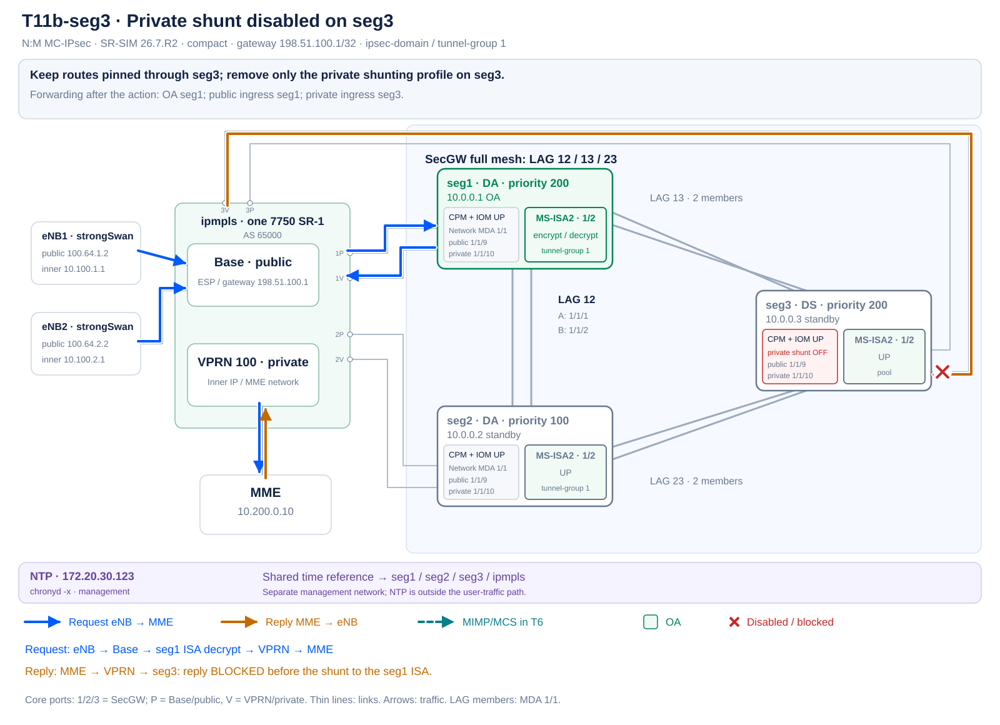

Remove private route pins after both variants. The gateway and both private /32 routes
must again use seg1. Unused prefix-list/policy definitions may remain; forwarding is restored
by removing neighbor import overrides, which cleanup verifies.

### T12 — Switchover with member A down and shunting over member B

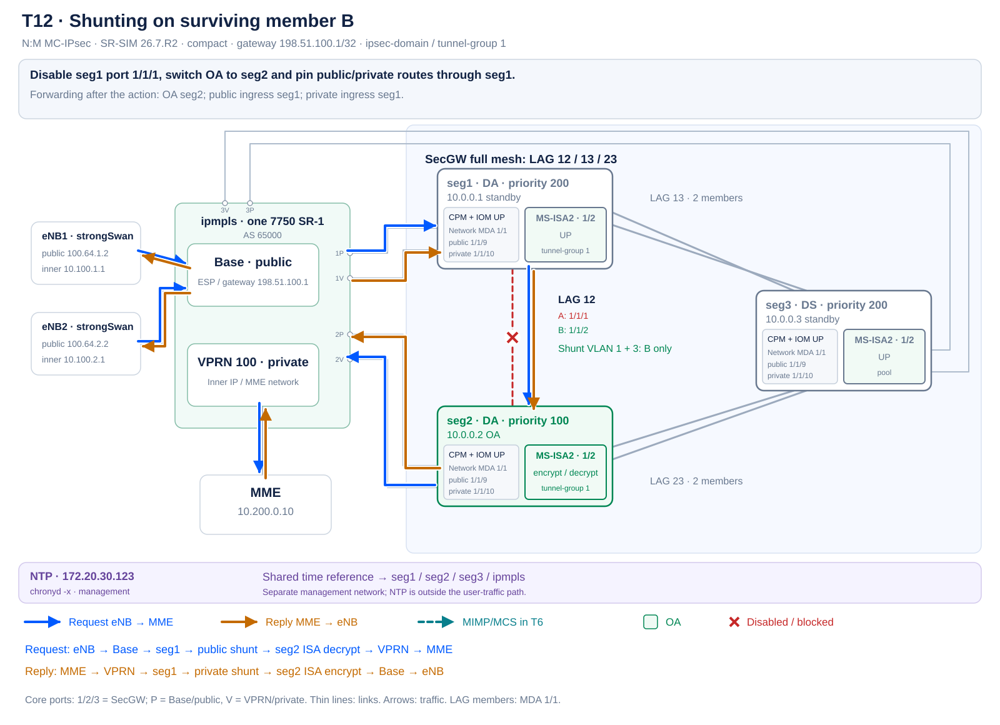

**Purpose:** exercise actual public/private shunted user traffic on the surviving member,
in addition to control-plane reachability after a port failure.

1. Start a stable measured window on nominal seg1.
2. Disable seg1 port 1/1/1, member A of LAG 12; leave member B enabled.
3. Check nominal and seg2 forwarding routes, then force switchover to seg2.
   Wait for stable traffic through the new OA.
4. On the core, pin the **gateway /32 and both private /32 routes through former OA seg1**.
5. Verify all selected next-hops, observe another 10 s and confirm stable traffic.

**Request:** eNB → core Base → seg1 public ingress → member-B public shunt →
seg2 ISA decrypt → private core → MME.

**Reply:** MME → core VPRN → seg1 private ingress → member-B private shunt →
seg2 ISA encrypt → public core → eNB.

Member B is 1/1/2 in compact and 2/1/1 in dual-IOM. Both VLAN 1 and VLAN 3 use the surviving
member. Require OA seg2, both original IKE pairs and recovered traffic through the pinned paths.
The complete T12 window includes the switchover loss; zero loss is not required over that full window.
The stable final part, with pins present and A disabled, demonstrates the surviving shunt path.

**Restore:** remove pins, enable A, verify two active LAG members and restore nominal seg1 baseline.

### T13 — Sequential DA failures with a normal pool

**Purpose:** validate the complete **seg1 → seg2 → seg3** forwarding sequence. This case
has an explicit intermediate checkpoint on seg2. T8 instead kills both DAs in one command
without waiting for verified forwarding on seg2.

**Initial state:** nominal domain, OA seg1, normal pool `none` on seg3, BFD enabled and
both original IKE/CHILD sessions present. Keep the core, eNBs, MME, NTP and all distributed
namespace helpers running throughout the two failures.

#### T13a — First failure: seg1 to seg2

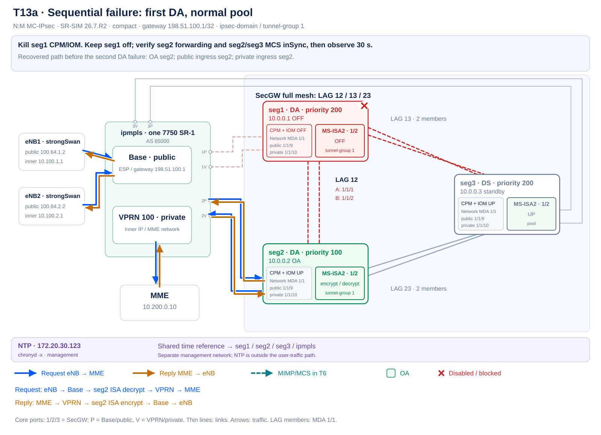

1. Start a measured ping window on both eNBs after ten successful replies and record both
   original IKE SPI pairs, domain state, routes and operational BFD sessions.
2. Kill seg1 CPM and its IOM components. Keep seg1 off through T13b.
3. Require unique OA seg2, two installed tunnels and all three core /32 routes through seg2.
4. Require recovered replies on both eNBs and MCS `inSync` between seg2 and seg3 in **both**
   directions. Record the surviving peers' domain, MCS, tunnel-group and BFD outputs.
5. Observe 30 s of forwarding with **no additional missing sequence numbers**. Recheck
   recovered traffic and the unchanged original IKE pairs before accepting the first stage.

**Traffic:** requests use eNB → core Base → seg2 ISA decrypt → core VPRN → MME.
Replies use MME → core VPRN → seg2 ISA encrypt → core Base → eNB.
seg3 remains standby; seg1 does not forward traffic.

After this fault, whole-domain protection is `notReady` because seg1 is absent. That is
the intended degraded state for the second failure. The surviving seg2/seg3 MCS adjacency
must still be synchronized; this test does not require or force a false nominal state.

#### T13b — Second failure: seg2 to seg3

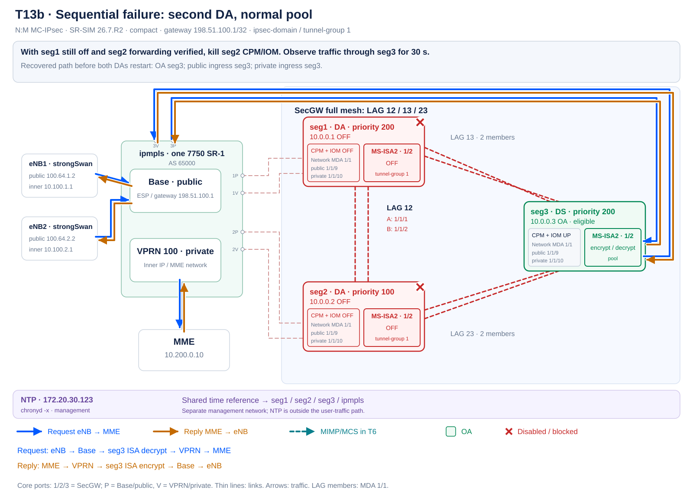

1. Start a separate measured window with both traffic directions routed through seg2.
   Verify that seg1 is still off and both IKE pairs match the original T13a pairs.
2. Kill seg2 CPM and its IOM components. Do not restart either DA during takeover measurement.
3. Require seg3 to be the unique forwarding owner, with two installed tunnels; while
   isolated, its domain Activity State is `eligible`. Require all core /32 routes through seg3.
4. Require recovered replies on both eNBs, then observe another 30 s without additional loss.
5. Compare both IKE pairs with the original pairs, retain the second fault's ping traces,
   and record seg3 and core operational evidence.

**Traffic:** requests use eNB → core Base → seg3 ISA decrypt → core VPRN → MME.
Replies use MME → core VPRN → seg3 ISA encrypt → core Base → eNB. Both DAs remain off.

The two faults have independent packet-loss and maximum-gap measurements. A new IKE
session between stages cannot be accepted as a stateful continuation. No manual IKE
initiation, force-switchover or peer-domain reset is used between the faults.

#### T13r — Return both DAs

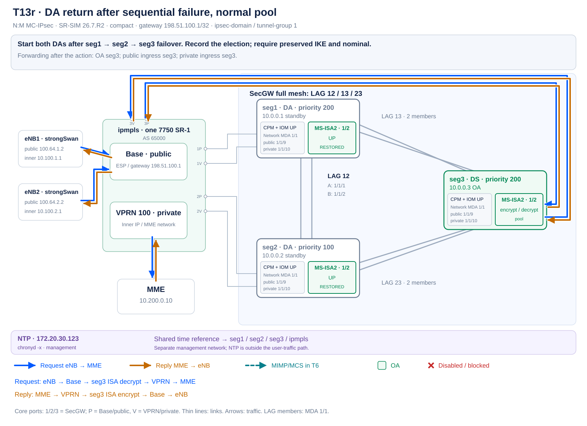

Start a third measured window through seg3 and verify that both IKE pairs still match T13a.
Start both DA CPM/IOM components, wait for their CLIs, all-domain nominal protection and
recovered traffic. Record the actual election result. Require a unique owner and preserved
original IKE pairs; require zero return-window loss when seg3 remains OA. Cleanup then
restores the nominal seg1 baseline. DA boot/reintegration time is separate from either
fault's traffic-restoration gap.

### T14 — Sequential DA failures with HA pool

Repeat the same three stages with seg3 pool configured as
`high-availability tunnel-limit-32k`. Use the cold HA preparation described under T9;
its restarts and readiness probes occur **before** T14a. The intermediate owner is still
seg2; HA preloads synchronized states on the seg3 pool ISA before seg2 fails.

#### T14a — First failure with HA standby

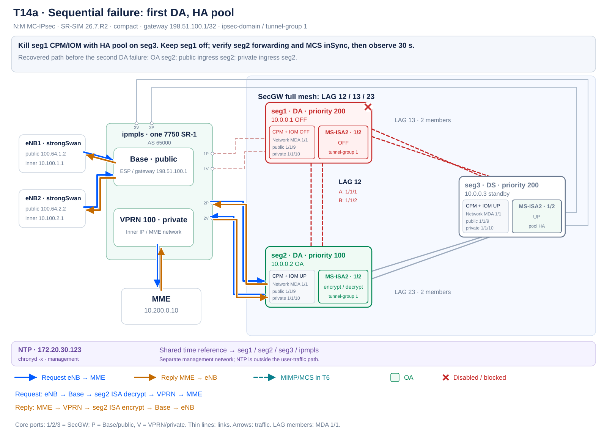

Kill seg1, verify OA seg2, two installed tunnels, all three core routes and both traffic
flows. Require seg2/seg3 MCS `inSync` in both directions and the same 30-s observation
without additional loss. Keep seg1 off. Retain both original IKE pairs for T14b/T14r.

#### T14b — Second failure and HA takeover

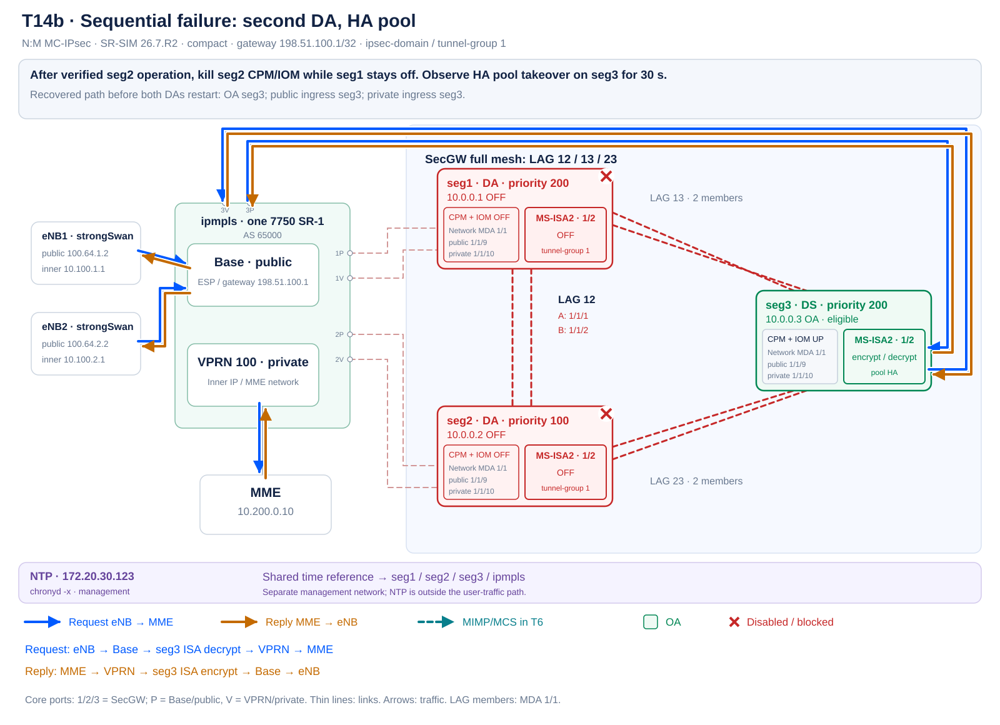

Kill seg2 only after T14a passes and seg1 is verified off. Require unique forwarding
owner seg3, two installed tunnels, all core routes through seg3, preserved original
IKE and recovered replies on both eNBs. Observe 30 s without additional loss. The request
and reply routes are the same as T13b; pool HA is the configuration difference.

#### T14r — DA return after HA takeover

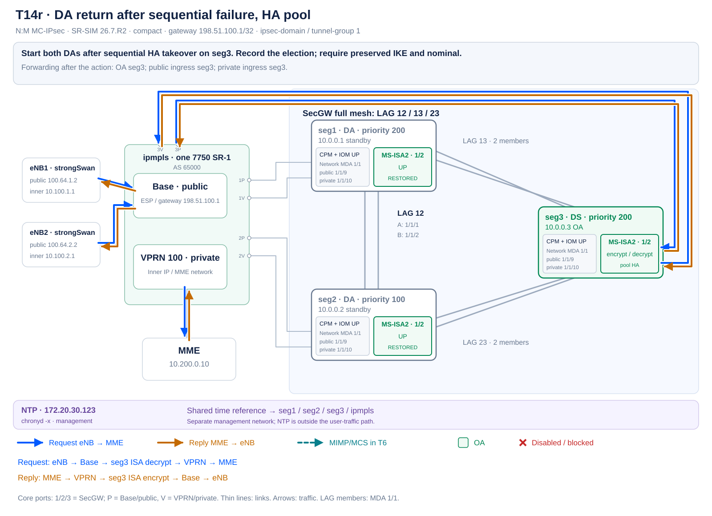

Measure both DAs returning as in T13r and preserve the T14a IKE pairs across the complete
chain. Record the actual OA, nominal protection and traffic result. Move forwarding to
seg1 before returning the pool to normal mode, then verify the full final baseline.

**Interpretation:** T13 and T14 validate sequential failure handling for two tunnels.
A single run per mode does not establish a statistically significant HA speed advantage.
Use the recorded operational BFD intervals when interpreting the observed gaps.

## Final restoration and acceptance

Cleanup starts disabled nodes, enables ISA/member ports, removes route pins and restores
public/private shunting, core BFD and non-revertive settings. Any revertive change is made
on a standby. Return the pool to normal mode `none` using the documented maintenance procedure.

Final acceptance requires:

- Unique OA seg1 and consistent Current Active 10.0.0.1, with nominal on every SecGW.
- Two installed tunnels on OA, both eNB IKE/CHILD sessions and complete forwarding routes.
- Gateway and both private /32 routes through seg1, with no temporary neighbor import overrides.
- Operational ISAs, two active members per LAG and MCS inSync with both peers on every SecGW.
- Selected shared NTP on all four SR OS nodes, BFD enabled and revertive false.
- Normal pool mode none and the intended configuration saved on all four routers.

The program includes a separate final operational check. If a precondition is not met,
stop the series, restore baseline and perform readiness checks before starting a new measurement.
The final protocol is linked from [RESULTS.md](../RESULTS.md).

## Nokia documentation basis

- [SR OS 26.7 IP tunnels](https://documentation.nokia.com/sr/26-7/7750-sr/books/ms-isa-esa/ip-tunnels.html):
  N:M election, protection, pool HA, synchronization, CHILD rekey, shunting and deployment requirements.
- [Revertive MD-CLI reference](https://documentation.nokia.com/sr/26-7/7750-sr/books/md-cli-command-reference/redundancy-redundancy_0.html#d43733):
  domain administration-state impact of changing revertive.
- [SR-SIM overview](https://documentation.nokia.com/sr/26-7/7x50-shared/srsim-installation-setup/sr-sim-overview.html):
  shared host resources and resource-allocation considerations.
- [SR-SIM host requirements](https://documentation.nokia.com/sr/26-7/7x50-shared/srsim-installation-setup/host-machine-requirements.html):
  boot memory versus feature/card-layout resource requirements.
